# A3: Feedback Data and Lumped-Model Memo

Feedback Data and
Lumped-Model Memo

Ricky Huang and Xavier Zhu | Phys 39 | 21 October 2026

**Result.** Historical P data show decreasing droop with gain and sustained high-gain oscillation. Three new PI runs remove most residual error; increasing Ki speeds the final heating correction but increases overshoot. A two-lump model explains internal lag and decaying ringing, but does not reproduce the sustained experimental P oscillation. Kp=20, Ki=0.2 is a moderate-overshoot choice among the tested PI settings, not a proven optimum.

**Evidence scope.** We reuse Module 5 P records as directed and retain the three physical PI runs from 19 October. The P records are not matched bidirectional runs, and their stable example Kp=4 is below the PI Kp=20. The high P experiment uses Kp=250, while the saved GUI simulation uses 100. These departures limit direct causal and protocol comparisons; missing measurements are not fabricated. Six original GUI screenshots are preserved, and six newly computed, standardized simulations provide numerical results.

## 1. One-lump model and P predictions

With thermal capacitance C [J/K], loss conductance H [W/K], and active-direction TEC coefficient Pu [W/PWM], conservation of energy gives:

$$
C\dot T=P_u u-H(T-T_{amb}),\quad \tau=C/H,\quad \chi=P_u/H
$$

$$
\tau\dot T=\chi u-(T-T_{amb})
$$

At steady state, Tss=Tamb+chi u. Substituting u=Kp(Tset-T) and collecting terms gives the droop and relaxation time:

$$
e_{ss}=\frac{T_{set}-T_{amb}}{1+\chi K_p},\quad \tau_{cl}=\frac{\tau}{1+\chi K_p},\quad L=\chi K_p
$$

L is dimensionless. Increasing Kp reduces the required error for a sustaining command and shortens the one-lump response time. The provisional Module 4 estimates are chi_h=0.49545, chi_c=0.14142 °C/PWM and tau=73.03 s. For Kp=4, Tamb=23.1885°C and Tset=30°C, predicted droop is 2.284°C versus the measured final-20-s 2.260°C; predicted tau_cl is 24.49 s. This agreement supports the static heating relation, not the entire transient model.

| Kp | Measured droop / °C | Predicted droop / °C | Predicted tau_cl / s |
| --- | --- | --- | --- |
| 0.25 | 6.000 | 6.061 | 64.98 |
| 0.5 | 5.230 | 5.459 | 58.53 |
| 1 | 4.502 | 4.555 | 48.83 |
| 2 | 3.230 | 3.421 | 36.68 |
| 4 | 2.260 | 2.284 | 24.49 |

Calibration caveat: some Module 4 endpoints were too short to establish the stricter late steady-state criterion. The 60.86-75.50 s range across six fitted steps is run-to-run variation, not a confidence interval. Only Pu/H and C/H follow directly from these thermal data.

## 2. Experimental responses and metrics

Three historical P examples use Kp=0.25, 4 and 250; three physical PI runs use Kp=20 and Ki=0.1, 0.2 and 0.5. PI retained run IDs are 3, 2 and 3 in the chronological files, respectively; short preliminary starts are excluded. Each PI run includes initial conditioning toward 20°C, an upward 30°C step and a return to 20°C. Integral memory is reset only before each run, then retained across target changes.

**Definitions.** Rise/fall time is the first 10%-to-90% traversal of the actual starting-temperature-to-target step, using linear interpolation. Overshoot is excursion beyond target divided by that step amplitude. Settling requires remaining within target ±0.2°C to record end with at least 60 s of later observations. Error means target minus measured temperature. Tail error uses the last 60 s; historical droop above uses 20 s. NR means not reached or not confirmed in the finite record; NA means unavailable.

| Case | Step | 10-90% / s | Overshoot / % | Settle / s | Tail error / °C |
| --- | --- | --- | --- | --- | --- |
| P 250 | up | 3.48 | 27.03 | NR | -0.441 |
| P 250 | down | NA | NA | NA | NA |
| PI 0.1 | up | 10.46 | 0.10 | 401.35 | 0.069 |
| PI 0.1 | down | 50.51 | 0.00 | 127.43 | -0.028 |
| PI 0.2 | up | 9.62 | 0.30 | 138.04 | 0.002 |
| PI 0.2 | down | 37.78 | 2.71 | 199.19 | 0.042 |
| PI 0.5 | up | 8.80 | 8.19 | 27.51 | -0.038 |
| PI 0.5 | down | 25.42 | 10.78 | 168.67 | 0.033 |

Largest P: initial T=20.90°C, maximum 32.46°C, 2.46°C overshoot (27.03% of its 9.10°C step), and no confirmed settling. Late positive peaks at Arduino time >=90 s give a mean period of 6.89 s. The record has 64/157 active measurements at full-scale reported PWM. Its tail average is not a stable equilibrium. No fixed-gain downward step was recorded, so downward metrics cannot be recovered.

Largest PI: Ki=0.5 has maxima/minima of 30.82/18.92°C. A single dominant excursion and recovery does not support a robust repeated-cycle period; its oscillation period is NA. The Ki=0.1 and 0.2 heating excursions of 0.01/0.03°C are small relative to the reported resolution and should not be treated as substantial overshoot.

All retained PI measurements report Safety=OK and no calculated output saturation. Median measurement interval is approximately 0.51 s. Event rows lack Arduino timestamps, so step origin has about one sample of uncertainty. Each recorded firmware PWM refers to the command active before that measurement; the next calculated command has a one-report offset. Firmware reporting does not measure electrical current.

## 2. Experimental evidence: P control

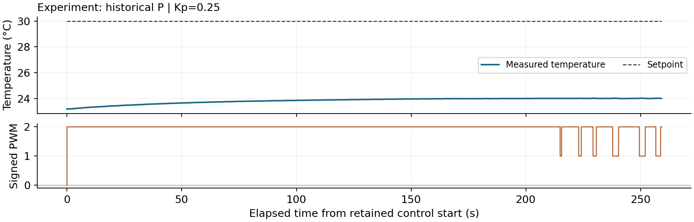

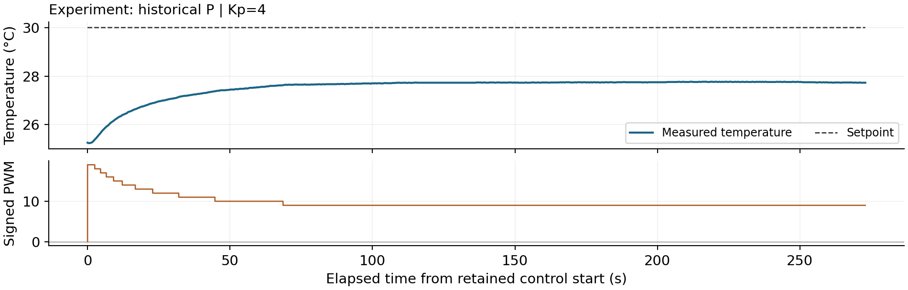

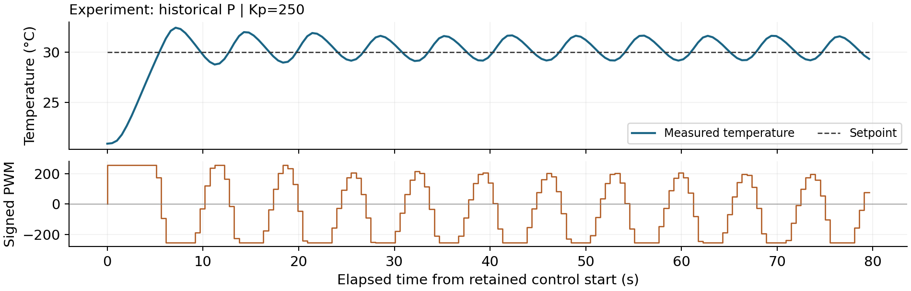

## 2. Experimental evidence: PI control

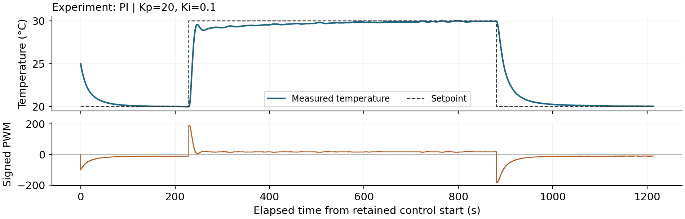

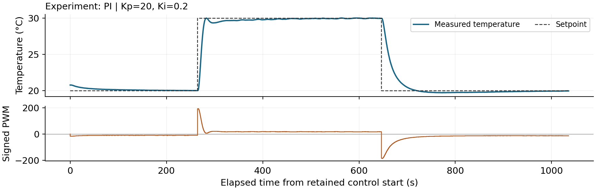

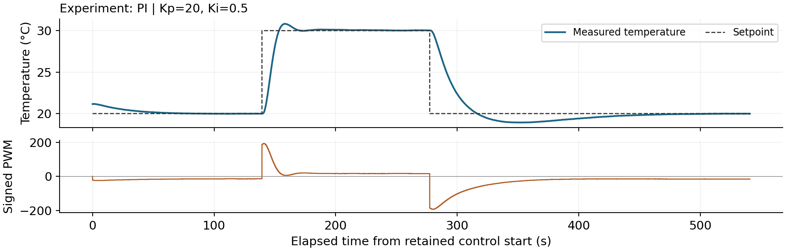

## 3. Two-lump model and derivation

The controller equations are unchanged; the process now has two thermal states. TEC-side temperature T responds to the applied power before the measured block temperature Tm. The term G(T-Tm) transfers the same heat out of the first lump and into the second:

$$
C_T\dot T=P_u(u)u-G(T-T_m)
$$

$$
C_m\dot T_m=G(T-T_m)-H(T_m-T_{amb})
$$

For perturbations about a fixed-direction unsaturated P equilibrium, CT thetaT_dot=-G thetaT+(G-Pu Kp) theta_m and Cm theta_m_dot=G thetaT-(G+H) theta_m. Solve the second relation for G thetaT, differentiate it and substitute the first relation. Defining:

$$
A=C_TC_m,\quad B=C_T(G+H)+C_mG,\quad D=G(H+P_uK_p)
$$

$$
A\ddot\theta_m+B\dot\theta_m+D\theta_m=0
$$

$$
\omega_n=\sqrt{D/A},\qquad \zeta_{2L,P}=B/(2\sqrt{AD})
$$

$$
K_{p,crit}=[B^2/(4AG)-H]/P_u
$$

All coefficients are positive, so the ideal two-lump P poles have negative real parts for positive gains. The threshold Kp,crit marks critical damping, not loss of stability: below it the response is overdamped; above it a complex pair produces decaying ringing. These statements assume no saturation, a fixed Pu branch and no extra delay.

**Shared simulation settings.** All six numerical runs use Tamb=23.19°C, both initial temperatures=23.0°C, chi_c=0.14142 and chi_h=0.49545 °C/PWM, tau=73.03 s, G=2 W/K, CT/C=0.35, assumed on-state VTEC=10 V and RM=1.50 ohm, PWM limit ±255, dt=0.05 s, and conditional anti-windup ON. Only controller gains change. The schedule is target20 for 0-300 s, target30 for 300-1000 s, then target20 for 1000-1500 s; q starts at zero and is retained at both steps. A fixed conditioning duration does not guarantee identical starting temperatures: those are recorded separately.

The assumed electrical values and measured-mode inversion yield C=53.9299 J/K, H=0.738463 W/K, Pu,c=0.104433 W/PWM, r=3.50339; CT=18.8755 and Cm=35.0544 J/K. These are model estimates conditional on VTEC and RM, not independent calorimetry. G and the capacitance division are unresolved structural estimates, not fitted measurements.

## 3. Stability calculations and classifications

Heating and cooling require different Pu, so each has its own local damping and stability thresholds. For the shared model, Kp,crit=5.642 on heating and 19.765 PWM/°C on cooling. The v3 GUI label "One-lump PI" is a different quantity and is not used to classify two-lump P.

| P simulation | zeta heating | zeta cooling | Local classification |
| --- | --- | --- | --- |
| Kp=0.25 | 1.838 | 1.915 | Stable overdamped |
| Kp=4 | 1.128 | 1.557 | Stable overdamped |
| Kp=100 | 0.274 | 0.501 | Stable underdamped |

Kp=0.25 and 4 lie below both thresholds; Kp=100 lies well above both. At Kp=100 the initial 10°C-step request exceeds ±255, so the linear zeta describes local recovery rather than the entire clipped transient.

### PI: a third-order stability problem

Adding q_dot=-theta_m to the two thermal states gives a cubic characteristic equation:

$$
As^3+Bs^2+Ds+GP_uK_i=0
$$

With positive coefficients, the Routh-Hurwitz criterion reduces to:

$$
BD>AGP_uK_i,\quad K_{i,crit}=B(H+P_uK_p)/(AP_u),\quad \rho_I=K_i/K_{i,crit}
$$

For Kp=20, Ki,crit=4.053 on heating and 4.983 PWM/(°C s) on cooling. Values 0<rhoI<1 imply local asymptotic stability, rhoI=1 a marginal imaginary pair, and rhoI>1 an unstable pair before clipping changes the dynamics.

| Ki | rhoI heating | rhoI cooling | Prediction |
| --- | --- | --- | --- |
| 0.1 | 0.0247 | 0.0201 | Stable; any ringing decays |
| 0.2 | 0.0493 | 0.0401 | Stable; any ringing decays |
| 0.5 | 0.1234 | 0.1003 | Stable; any ringing decays |

All three PI settings are far below the stability boundary. Their local heating responses are stable underdamped (one real pole and a complex pair). Cooling at Ki=0.1 and 0.2 has real negative poles; Ki=0.5 has a decaying complex pair. Controller memory and the zero can cause a single undershoot even with real poles. No retained PI case is marginal or unstable. A third-order PI response has no unique whole-system second-order zeta. These local branch tests do not certify all nonlinear operating conditions.

As an independent arithmetic check, roots of each characteristic polynomial were compared with eigenvalues of the corresponding thermal/controller state matrix; they agree within 1e-10 s^-1. Halving dt to 0.025 s changes the measured-mass temperature by at most 0.024°C over the complete standardized trajectories.

## 3. Standardized two-lump simulations: P

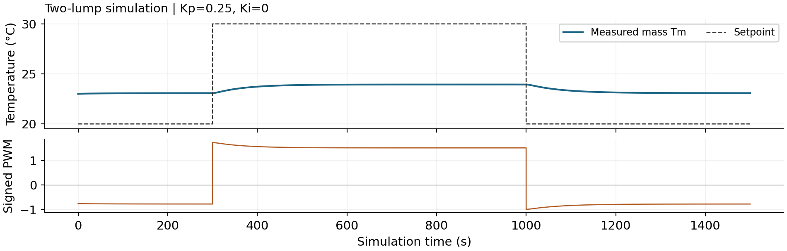

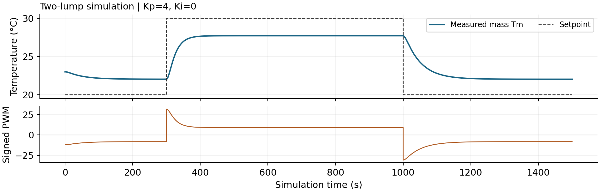

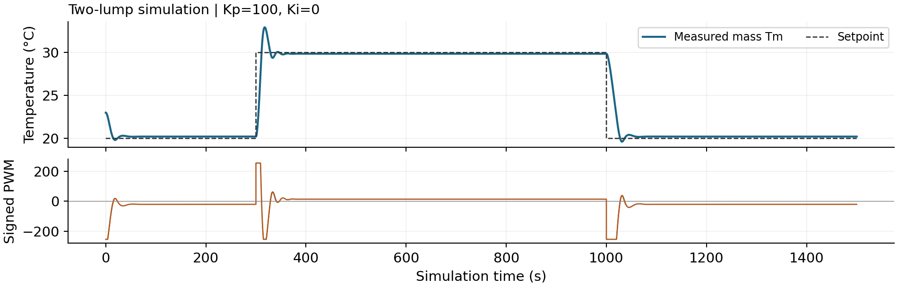

## 3. Standardized two-lump simulations: PI

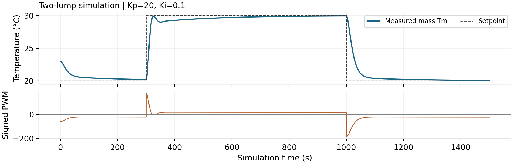

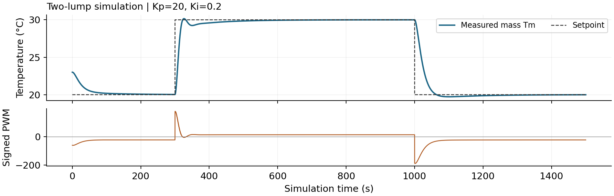

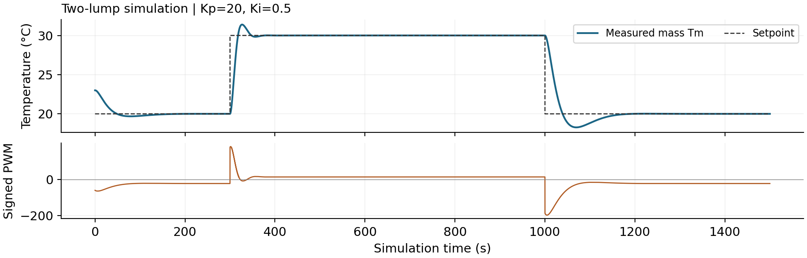

## 3. Experiment-model comparison

The six simulations above are newly computed with the teacher v3 core and a reproducible common schedule, not numerical traces extracted from screenshots. The six operator GUI screenshots remain source evidence. Five use chi_h=0.49545; the Kp=100 screenshot displays 0.495. Recalculation standardizes that small mismatch. Different GUI switch times and finite conditioning also prevent exact screenshot-to-recalculation timing identity. Experimental plots retain their native time and temperature ranges to resolve the short P oscillation and longer PI recovery; compare axis labels and aligned step metrics, not apparent slopes across differently scaled panels.

| Ki | Step | Overshoot °C
exp / sim | Settle s
exp / sim | 10-90% s
exp / sim |
| --- | --- | --- | --- | --- |
| 0.1 | up | 0.01/0.00 | 401.35/374.35 | 10.46/14.44 |
| 0.1 | down | 0.00/0.00 | 127.43/251.95 | 50.51/46.63 |
| 0.2 | up | 0.03/0.15 | 138.04/173.25 | 9.62/13.98 |
| 0.2 | down | 0.27/0.28 | 199.19/153.05 | 37.78/37.12 |
| 0.5 | up | 0.82/1.39 | 27.51/44.00 | 8.80/12.06 |
| 0.5 | down | 1.08/1.73 | 168.67/152.80 | 25.42/27.18 |

### Four comparison answers

**1. Closest examples.** P Kp=4 reproduces static droop well: simulation 2.284°C versus measurement 2.260°C. PI Ki=0.2 approximately reproduces cooling rise/fall time (37.78 versus 37.12 s) and undershoot (0.27 versus 0.28°C). No single PI run matches all rise, overshoot and settling metrics; Ki=0.1 heating settling is relatively close, while its cooling recovery is too slow in the model.

**2. P ordering.** Decreasing zeta as Kp crosses Kp,crit organizes the simulations from strongly damped droop to faster decaying ringing. Kp=100 is not interchangeable with experimental 250. The latter has sustained late oscillation; the ideal linear P model cannot reproduce that classification at any positive gain.

**3. PI ordering.** rhoI increases with Ki, while Ki,crit stays fixed at a given branch and Kp. All three are stable locally. The larger-Ki run has stronger integral memory and greater overshoot. Cooling settling is not monotonic with Ki, so a faster first crossing alone is not evidence of better regulation.

**4. Agreement and disagreement.** Both model and experiment show smaller P droop with gain and increased PI excursion with Ki. The Ki=0.5 model overpredicts excursions: 1.39/1.73°C versus measured 0.82/1.08°C up/down. Its heating rise is also slower. Sustained experimental P oscillation remains a larger qualitative disagreement, with omitted sampling delay and additional thermal dynamics plausible explanations rather than demonstrated causes.

## 4. PI steady state, assumptions and windup

$$
\dot q=e,\quad u_P=K_pe,\quad u_I=K_iq,\quad u=\mathrm{clip}(u_P+u_I,-255,255)
$$

### Ideal 55°C question

If a stable equilibrium exists with Ki>0 and continued unsaturated integration, q must stop changing. Therefore e=0:

$$
\dot q=0\Rightarrow e=0\Rightarrow T_{ss}=T_{set}=55\,^{\circ}\mathrm C
$$

$$
u_{ss}=H(T_{set}-T_{amb})/P_u=(T_{set}-T_{amb})/\chi,\quad q_{ss}=u_{ss}/K_i
$$

Using the provisional heating susceptibility and Tamb=23.19°C gives u_ss≈64.20 PWM, below 255. That arithmetic does not establish actual reachability at 55°C: the coefficient is extrapolated, thermal/electrical limits may change, and the physical Python controller deliberately accepts only 10-45°C. The 55°C result here is theoretical; no physical 55°C test is claimed.

The result requires closed-loop stability, sufficient actuator authority, a reachable equilibrium, reliable unbiased temperature measurement, and integral action that is neither disabled, reset repeatedly nor frozen permanently by saturation. A biased sensor can have zero indicated error while the actual block temperature is wrong. Delay and extra states can invalidate the ideal stability prediction.

### Windup and the implemented rule

While saturated, persistent error can keep growing q although output cannot increase. Once the target is reached, the stored I term may continue driving in the previous direction. The controller proposes q_new=q+e dt; if Kp e+Ki q_new exceeds the positive limit with e>0, or falls below the negative limit with e<0, that update is rejected. Integration that unwinds saturation is allowed. The output clamp and Arduino temperature shutdown remain separate.

Physical dt is computed from accepted Arduino timestamps, with repeated/reversed times or gaps >2 s disarming control. The firmware temperature cutoff is 60°C; the Python operating range is narrower. Stop sends PWM0 before mode changes/reset. These protections do not prove that an electrical output actually reaches the TEC.

### Reset after reaching equilibrium

For a nonambient target, the I term supplies nonzero sustaining power. Resetting q makes u_I=0; initially e=0 also makes u_P=0, so that sustaining output disappears. Above ambient the block tends to cool, error grows, and the controller must rebuild its integral. In two-lump dynamics stored TEC heat may delay the observed drop. In the implemented Zero integral + STOP action, output is explicitly zero and control remains stopped until restarted.

The retained PI runs never reach their PWM clamp, so their overshoot is not evidence of saturation-induced windup. At Ki=0.5 on the downward step, the sample Tm=19.97°C has u_P=+0.60 and u_I≈-62.78 PWM: the integral still requests cooling after the target crossing. This directly supports controller memory, with thermal storage as an additional modeled contributor.

## 5. Model limits and gain selection

### Why ideal one-lump P cannot overshoot

$$
T(t)=T_{ss}+(T_0-T_{ss})e^{-t/\tau_{cl}}
$$

For positive C, H, Pu and Kp, tau_cl>0 and the exponential never changes sign. T-Tss therefore keeps its initial sign and decays monotonically. Starting below both the equilibrium and a higher target, this model cannot cross the equilibrium or overshoot that target. An arbitrary initial condition already above the target is not a step-response overshoot prediction.

### What the second lump changes

The error is based on Tm, not the hidden TEC-side T. During heating the TEC can store energy while Tm remains low; the continuing error sustains drive. Reducing or reversing drive does not instantly remove that stored energy. Two thermal states permit a complex pole pair even though there is no mechanical inertia. At equilibrium the global balance is still Pu u=H(Tm-Tamb), so the same P droop law survives.

$$
T-T_m=(H/G)(T_m-T_{amb})
$$

At Tm=30°C the shared model predicts T-Tm≈2.51°C; at 20°C it predicts about -1.18°C. Thus separated TEC and block curves are normal even in steady state. Ki changes transient memory and excursion, not this steady gap at a fixed achievable target and unchanged physical parameters.

### Selected gains within the tested set

**P reference:** Kp=4 is the best stable P example among the three selected historical gains: it reduces droop without the sustained ringing at 250. Its model zeta is 1.128 heating and 1.557 cooling, both above 1; Kp=4 is below both critical-damping gains. Its 2.26°C droop is still unacceptable for precise target regulation. There is no systematic stable-gain sweep between 4 and 250, so the optimum P gain is not known.

**PI working choice:** Kp=20, Ki=0.2 balances the tested heating speed and limited excursions. rhoI=0.0493/0.0401 heating/cooling indicates a wide local model margin; the equivalent P-only Kp=20 exceeds the heating critical-damping threshold, which permits transient ringing without implying instability. Measured heating settles in 138 s, and cooling undershoot is 0.27°C. Ki=0.5 is preferable only if faster heating is worth 0.82°C upward and 1.08°C downward excursions; Ki=0.1 has the gentlest cooling but slower final heating correction.

This is a preference for moderate overshoot, not a mathematical optimum or proof of robust stability. The PI Kp is not slightly below the historical P reference; therefore the P-to-PI speed change cannot be attributed only to integral action.

### What a better model should add

A useful next extension is explicit sample-and-hold and sensor/transport delay: approximately 0.51 s updates, ADC averaging, serial latency and additional thermal states can materially affect high-gain stability. Direction-dependent or temperature-dependent heat transfer, an extra TEC-to-room path, and nonideal contacts may also improve the excursion mismatch. The current G and capacitance split were assumed, not uniquely identified. None of these mechanisms is singled out by the present data.

## Evidence, reproducibility and limitations

### Source records

Repository: https://github.com/zhuyanheng/Phys39-teamR-X . All paths below are relative to its root. The paper is supported by the retained local files, not a claim that they have already been published remotely.

P Kp=0.25: Module_5/data/20260930_110723_droop_kp0p25.csv

P Kp=4: Module_5/data/20260930_112955_droop_kp4.csv

P Kp=250: Module_5/data/20261007_105005_kp250_20to30c_oscillation.csv

PI Ki=0.1: Module_6/data/physical/pi_kp_20_ki_0p1_20261019_093424_268559.csv

PI Ki=0.2: Module_6/data/physical/pi_kp_20_ki_0p2_20261019_095648_364327.csv

PI Ki=0.5: Module_6/data/physical/pi_kp_20_ki_0p5_20261019_101544_769937.csv

Additional P droop points: Module_5/data/20260930_111214_droop_kp0p5.csv, 20260930_112131_droop_kp1.csv and 20260930_112429_droop_kp2.csv. Calibration: Module_4/data/steady_state.csv and Module_6/data/model_baseline/time_constants.csv. Original screenshots are in Module_6/figures/gui/two_lump/: p_kp_0p25.png, p_kp_4.png, p_kp_100.png, and pi_kp_20_ki_0p1.png, pi_kp_20_ki_0p2.png, pi_kp_20_ki_0p5.png.

### Reproduction

.venv/bin/python Module_6/python/analysis/analyze_retained_experiments.py

.venv/bin/python Module_6/python/analysis/prepare_a3_evidence.py

Module_6/run_gui.command

PDF generation: bundled Python runs Module_6/python/analysis/build_a3_report.py. Its output is Module_6/output/pdf/A3_Huang_Zhu.pdf. Editable text: Module_6/docs/a3_feedback_model.md. Numerical CSVs, stability calculations, time-step checks and SHA256 provenance: Module_6/data/a3/. The source module is preserved with a startup compatibility patch; its SHA256 in provenance.json identifies the exact calculation code used. No hardware is accessed by these analysis scripts.

### Course references

[1] Phys 39, Module 6 Part I: P/PI Control and Lumped Modeling. https://sethfraden.github.io/Phys39F26-course/labs/lab-06/ (accessed 21 October 2026).

[2] Phys 39, Module 6 Part II: TEC Process Model and the Simulation. https://sethfraden.github.io/Phys39F26-course/labs/lab-07/ (accessed 21 October 2026).

### Readiness and evidence gaps

The analysis addresses Questions 1-5 with available evidence and twelve clearly labeled plots, but it is not a fully matched six-run experimental study. Missing historical P downward steps, unequal experimental P/PI Kp, unequal high-gain P experiment/simulation values, unmeasured electrical assumptions and nonidentical conditioning remain explicit limitations. Exact instability-onset thresholds and globally optimal gains were not measured. No instructor approval record, remote Git checkpoint, Moodle upload or repeat-run uncertainty estimate is asserted.

AI assisted with code, calculations, figures and writing. Numerical simulation results are distinguished from measured data and operator screenshots. The team should review the interpretation and assignment deviations before submission.
