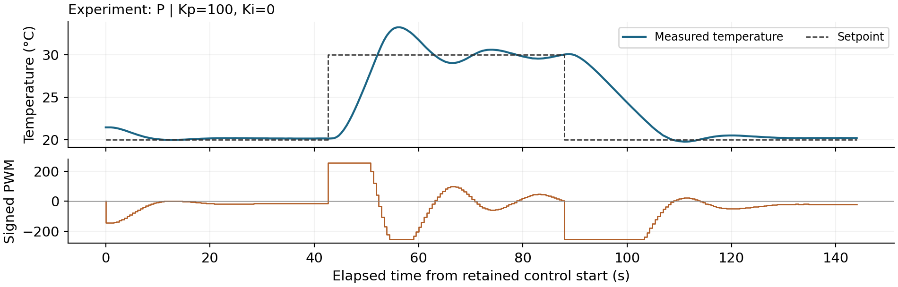

# A3: Feedback Data and Lumped-Model Memo

Feedback Data and
Lumped-Model Memo

Ricky Huang and Xavier Zhu | Phys 39 | 21 October 2026

**Result.** New Module 6 P measurements show large low-gain droop and decaying high-gain ringing. Three PI runs remove most residual error; increasing Ki speeds final heating correction but increases overshoot. The two-lump model captures these qualitative trends, while its quantitative excursions and branch-dependent speeds remain imperfect. Kp=20, Ki=0.2 is a moderate-overshoot choice among the tested PI settings, not a proven optimum.

**Evidence scope.** P evidence is now exclusively from 21 October Module 6 measurements at Kp=0.25, 4 and 100; the earlier P evidence is excluded. PI evidence remains the three 19 October Module 6 runs. All six have target 20-30-20 and limit ±255, and the P simulation gains now match the P experiments. High-P segments last only 45/56 s, so they cannot confirm a 60-s settling criterion. Days, conditioning and room temperature are not fully matched, and PI Kp=20 is above the middle P gain4. Six operator screenshots are preserved separately from the standardized numerical simulations.

## 1. One-lump model and P predictions

With thermal capacitance C [J/K], loss conductance H [W/K], and active-direction TEC coefficient Pu [W/PWM], conservation of energy gives:

$$
C\dot T=P_u u-H(T-T_{amb}),\quad \tau=C/H,\quad \chi=P_u/H
$$

$$
\tau\dot T=\chi u-(T-T_{amb})
$$

At steady state, Tss=Tamb+chi u. Substituting u=Kp(Tset-T) and collecting terms gives the droop and relaxation time:

$$
e_{ss}=\frac{T_{set}-T_{amb}}{1+\chi K_p},\quad \tau_{cl}=\frac{\tau}{1+\chi K_p},\quad L=\chi K_p
$$

L is dimensionless. Increasing Kp reduces P droop and shortens the ideal one-lump response time. Provisional Module 4 estimates are chi_h=0.49545, chi_c=0.14142 °C/PWM and tau=73.03 s. A Module 4 example supplies the requested prediction comparison: at +34 PWM, nominal Tamb=23.44°C gives Tss=23.44+34(0.495446)=40.285°C versus measured final-20-s 40.421°C. Trace RMSE is 0.180°C, but the time constant is calibrated from that same H3 trace, so this is calibration reuse, not independent transient validation.

| New P Kp | Heating tail20 error / °C | Cooling tail20 error / °C | Nominal tau_cl heat / s |
| --- | --- | --- | --- |
| 0.25 | 7.819 | -1.739 | 64.98 |
| 4 | 2.864 | -1.220 | 24.49 |

Tail20 values describe the finite new records, not proven infinite-time droop. The high-gain transient is evaluated separately. The 23.19°C model room temperature is a nominal reference, not a new room measurement. Lower low-gain temperatures than the model predicts cannot be attributed uniquely to an incorrect gain or susceptibility. Some Module 4 endpoints are short; the 60.86-75.50 s range of fitted time constants is run variation, not a confidence interval.

## 2. Experimental responses and metrics

P gains are 0.25, 4 and 100, with Ki=0 and retained run_id=1 in each new file. PI uses Kp=20 and Ki=0.1, 0.2, 0.5 with retained run IDs 3, 2, 3. Short PI preliminary starts are excluded. Each retained run includes target 20 conditioning, target 30, then target 20. PI integral memory is reset before the run and retained across target steps; P has no active integral.

**Definitions.** Rise/fall time is the interpolated first 10%-to-90% traversal from actual post-step starting temperature toward target. Overshoot is excursion beyond target divided by that amplitude. Settling requires all remaining samples within target ±0.2°C and at least 60 s of later observations. NR means not reached/confirmed; NA means unavailable. Error is target minus measurement. Tail60 is reported only for segments >=60 s; otherwise it is NA. Tail20 is a short-record endpoint average, never assumed to be equilibrium.

| Case | Step | 10-90% / s | Overshoot / % | Settle / s | Tail60 error / °C |
| --- | --- | --- | --- | --- | --- |
| P 100 | up | 5.89 | 32.56 | NR | NA |
| P 100 | down | 13.49 | 2.30 | NR | NA |
| PI 0.1 | up | 10.46 | 0.10 | 401.35 | 0.069 |
| PI 0.1 | down | 50.51 | 0.00 | 127.43 | -0.028 |
| PI 0.2 | up | 9.62 | 0.30 | 138.04 | 0.002 |
| PI 0.2 | down | 37.78 | 2.71 | 199.19 | 0.042 |
| PI 0.5 | up | 8.80 | 8.19 | 27.51 | -0.038 |
| PI 0.5 | down | 25.42 | 10.78 | 168.67 | 0.033 |

Largest P: heating starts at 20.14°C, reaches 33.21°C and overshoots by 3.21°C (32.56%); 10-90% rise is 5.89 s. Cooling starts at 30.01°C, reaches 19.77°C (0.23°C undershoot, 2.30%), with 13.49 s fall. Records last 44.79/56.07 s, so confirmed settling and full 60-s tail means are unavailable. Last 20-s errors are +0.061/-0.227°C up/down; the full transient average is not a steady-state error.

The two prominent heating peaks 33.21 and 30.58°C are 17.81 s apart, with troughs 29.01 then 29.53°C: observed oscillations decay. This single peak interval is only a rough transient-period estimate. Cooling lacks enough prominent repeated cycles for a period. Full-scale applied samples are 25/89 heating and 30/111 cooling, so saturation affects the transient.

Largest PI remains Ki=0.5: peak 30.82°C, minimum 18.92°C. Its single dominant excursion does not support a repeated-cycle period. All PI measurements report no calculated saturation. Across all six retained runs Safety=OK and median sampling is about 0.51 s. P low-gain initial conditioning lasts only 25.79 s, and its final cooling record is still drifting; both limitations remain visible.

Event rows lack Arduino timestamps, so step origins have about one-sample uncertainty. Firmware PWM was active before the measurement; next-sent PWM has a one-report offset. Firmware reporting does not measure actual electrical current.

## 2. Experimental evidence: P control

## 2. Experimental evidence: PI control

## 3. Two-lump model and derivation

The controller equations are unchanged; the process now has two thermal states. TEC-side temperature T responds to the applied power before the measured block temperature Tm. The term G(T-Tm) transfers the same heat out of the first lump and into the second:

$$
C_T\dot T=P_u(u)u-G(T-T_m)
$$

$$
C_m\dot T_m=G(T-T_m)-H(T_m-T_{amb})
$$

For perturbations about a fixed-direction unsaturated P equilibrium, CT thetaT_dot=-G thetaT+(G-Pu Kp) theta_m and Cm theta_m_dot=G thetaT-(G+H) theta_m. Solve the second relation for G thetaT, differentiate it and substitute the first relation. Defining:

$$
A=C_TC_m,\quad B=C_T(G+H)+C_mG,\quad D=G(H+P_uK_p)
$$

$$
A\ddot\theta_m+B\dot\theta_m+D\theta_m=0
$$

$$
\omega_n=\sqrt{D/A},\qquad \zeta_{2L,P}=B/(2\sqrt{AD})
$$

$$
K_{p,crit}=[B^2/(4AG)-H]/P_u
$$

All coefficients are positive, so the ideal two-lump P poles have negative real parts for positive gains. The threshold Kp,crit marks critical damping, not loss of stability: below it the response is overdamped; above it a complex pair produces decaying ringing. These statements assume no saturation, a fixed Pu branch and no extra delay.

**Shared simulation settings.** All six numerical runs use Tamb=23.19°C, both initial temperatures=23.0°C, chi_c=0.14142 and chi_h=0.49545 °C/PWM, tau=73.03 s, G=2 W/K, CT/C=0.35, assumed on-state VTEC=10 V and RM=1.50 ohm, PWM limit ±255, dt=0.05 s, and conditional anti-windup ON. Only controller gains change. The schedule is target 20 for 0-300 s, target 30 for 300-1000 s, then target 20 for 1000-1500 s; q starts at zero and is retained at both steps. A fixed conditioning duration does not guarantee identical starting temperatures: those are recorded separately.

The assumed electrical values and measured-mode inversion yield C=53.9299 J/K, H=0.738463 W/K, Pu,c=0.104433 W/PWM, r=3.50339; CT=18.8755 and Cm=35.0544 J/K. These are model estimates conditional on VTEC and RM, not independent calorimetry. G and the capacitance division are unresolved structural estimates, not fitted measurements.

## 3. Stability calculations and classifications

Heating and cooling require different Pu, so each has its own local damping and stability thresholds. For the shared model, Kp,crit=5.642 on heating and 19.765 PWM/°C on cooling. The v3 GUI label "One-lump PI" is a different quantity and is not used to classify two-lump P.

| P simulation | zeta heating | zeta cooling | Local classification |
| --- | --- | --- | --- |
| Kp=0.25 | 1.838 | 1.915 | Stable overdamped |
| Kp=4 | 1.128 | 1.557 | Stable overdamped |
| Kp=100 | 0.274 | 0.501 | Stable underdamped |

Kp=0.25 and 4 lie below both thresholds; Kp=100 lies well above both. At Kp=100 the initial 10°C-step request exceeds ±255, so the linear zeta describes local recovery rather than the entire clipped transient.

### PI: a third-order stability problem

Adding q_dot=-theta_m to the two thermal states gives a cubic characteristic equation:

$$
As^3+Bs^2+Ds+GP_uK_i=0
$$

With positive coefficients, the Routh-Hurwitz criterion reduces to:

$$
BD>AGP_uK_i,\quad K_{i,crit}=B(H+P_uK_p)/(AP_u),\quad \rho_I=K_i/K_{i,crit}
$$

For Kp=20, Ki,crit=4.053 on heating and 4.983 PWM/(°C s) on cooling. Values 0<rhoI<1 imply local asymptotic stability, rhoI=1 a marginal imaginary pair, and rhoI>1 an unstable pair before clipping changes the dynamics.

| Ki | rhoI heating | rhoI cooling | Prediction |
| --- | --- | --- | --- |
| 0.1 | 0.0247 | 0.0201 | Stable; any ringing decays |
| 0.2 | 0.0493 | 0.0401 | Stable; any ringing decays |
| 0.5 | 0.1234 | 0.1003 | Stable; any ringing decays |

All three PI settings are far below the stability boundary. Their local heating responses are stable underdamped (one real pole and a complex pair). Cooling at Ki=0.1 and 0.2 has real negative poles; Ki=0.5 has a decaying complex pair. Controller memory and the zero can cause a single undershoot even with real poles. No retained PI case is marginal or unstable. A third-order PI response has no unique whole-system second-order zeta. These local branch tests do not certify all nonlinear operating conditions.

As an independent arithmetic check, roots of each characteristic polynomial were compared with eigenvalues of the corresponding thermal/controller state matrix; they agree within 1e-10 s^-1. Halving dt to 0.025 s changes the measured-mass temperature by at most 0.024°C over the complete standardized trajectories.

## 3. Standardized two-lump simulations: P

## 3. Standardized two-lump simulations: PI

## 3. Experiment-model comparison

The six curves above are new calculations using the teacher v3 core and a common schedule, not numerical traces extracted from screenshots. The P gains 0.25, 4, 100 now exactly match the new experiments. One original screenshot has chi_h=0.495 instead of0.49545; recalculation standardizes this. Room temperature and actual starting states were not independently matched across 21 October P, 19 October PI and the nominal model. Compare axis labels and aligned metrics, not differently scaled apparent slopes.

| Case | Step | Overshoot °C
exp / sim | Settle s
exp / sim | 10-90% s
exp / sim |
| --- | --- | --- | --- | --- |
| P100 | up | 3.21/2.94 | NR/55.90 | 5.89/7.52 |
| P100 | down | 0.23/0.38 | NR/NR | 13.49/18.71 |
| PI 0.1 | up | 0.01/0.00 | 401.35/374.35 | 10.46/14.44 |
| PI 0.1 | down | 0.00/0.00 | 127.43/251.95 | 50.51/46.63 |
| PI 0.2 | up | 0.03/0.15 | 138.04/173.25 | 9.62/13.98 |
| PI 0.2 | down | 0.27/0.28 | 199.19/153.05 | 37.78/37.12 |
| PI 0.5 | up | 0.82/1.39 | 27.51/44.00 | 8.80/12.06 |
| PI 0.5 | down | 1.08/1.73 | 168.67/152.80 | 25.42/27.18 |

### Four comparison answers

**1. Closest examples.** P100 reproduces overshoot and decaying ringing: measured/model heating peaks 33.21/32.94°C, with rise 5.89/7.52 s. Cooling undershoot is 0.23/0.38°C, with fall 13.49/18.71 s. Exact settling cannot be compared because the physical windows are too short. PI 0.2 approximately reproduces cooling fall 37.78/37.12 s and undershoot 0.27/0.28°C, but no setting matches every metric.

**2. P ordering.** The low and middle gains are below both Kp,crit values, while 100 is above both. The model transitions from overdamped droop to stable underdamped ringing; new high-P peak/trough amplitudes also decrease. The new record provides no evidence of sustained or growing oscillation. It is too short to establish long-time asymptotic behavior.

**3. PI ordering.** rhoI grows with Ki while Ki,crit remains fixed. All three are locally stable. Larger integral memory increases excursion and shortens final heating correction, but cooling settling is not monotonic. Overshoot alone is not instability.

**4. Agreement and disagreement.** Qualitative P damping and PI trends agree. Quantitatively, the nominal model predicts P4 heating final 27.716°C versus measured tail 27.134°C, and P0.25 predicts 23.941°C versus 22.151°C. A changed room temperature is plausible but unmeasured; finite conditioning and coefficient transfer also matter. PI 0.5 overpredicts excursions 1.39/1.73°C versus 0.82/1.08°C. These mismatches prevent a claim of complete quantitative validation.

## 4. PI steady state, assumptions and windup

$$
\dot q=e,\quad u_P=K_pe,\quad u_I=K_iq,\quad u=\mathrm{clip}(u_P+u_I,-255,255)
$$

### Ideal 55°C question

If a stable equilibrium exists with Ki>0 and continued unsaturated integration, q must stop changing. Therefore e=0:

$$
\dot q=0\Rightarrow e=0\Rightarrow T_{ss}=T_{set}=55\,^{\circ}\mathrm C
$$

$$
u_{ss}=H(T_{set}-T_{amb})/P_u=(T_{set}-T_{amb})/\chi,\quad q_{ss}=u_{ss}/K_i
$$

Using the provisional heating susceptibility and Tamb=23.19°C gives u_ss≈64.20 PWM, below 255. That arithmetic does not establish actual reachability at 55°C: the coefficient is extrapolated, thermal/electrical limits may change, and the physical Python controller deliberately accepts only 10-45°C. The 55°C result here is theoretical; no physical 55°C test is claimed.

The result requires closed-loop stability, sufficient actuator authority, a reachable equilibrium, reliable unbiased temperature measurement, and integral action that is neither disabled, reset repeatedly nor frozen permanently by saturation. A biased sensor can have zero indicated error while the actual block temperature is wrong. Delay and extra states can invalidate the ideal stability prediction.

### Windup and the implemented rule

While saturated, persistent error can keep growing q although output cannot increase. Once the target is reached, the stored I term may continue driving in the previous direction. The controller proposes q_new=q+e dt; if Kp e+Ki q_new exceeds the positive limit with e>0, or falls below the negative limit with e<0, that update is rejected. Integration that unwinds saturation is allowed. The output clamp and Arduino temperature shutdown remain separate.

Physical dt is computed from accepted Arduino timestamps, with repeated/reversed times or gaps >2 s disarming control. The firmware temperature cutoff is 60°C; the Python operating range is narrower. Stop sends PWM0 before mode changes/reset. These protections do not prove that an electrical output actually reaches the TEC.

### Reset after reaching equilibrium

For a nonambient target, the I term supplies nonzero sustaining power. Resetting q makes u_I=0; initially e=0 also makes u_P=0, so that sustaining output disappears. Above ambient the block tends to cool, error grows, and the controller must rebuild its integral. In two-lump dynamics stored TEC heat may delay the observed drop. In the implemented Zero integral + STOP action, output is explicitly zero and control remains stopped until restarted.

The retained PI runs never reach their PWM clamp, so their overshoot is not evidence of saturation-induced windup. At Ki=0.5 on the downward step, the sample Tm=19.97°C has u_P=+0.60 and u_I≈-62.78 PWM: the integral still requests cooling after the target crossing. This directly supports controller memory, with thermal storage as an additional modeled contributor.

## 5. Model limits and gain selection

### Why ideal one-lump P cannot overshoot

$$
T(t)=T_{ss}+(T_0-T_{ss})e^{-t/\tau_{cl}}
$$

For positive C, H, Pu and Kp, tau_cl>0 and the exponential never changes sign. T-Tss therefore keeps its initial sign and decays monotonically. Starting below both the equilibrium and a higher target, this model cannot cross the equilibrium or overshoot that target. An arbitrary initial condition already above the target is not a step-response overshoot prediction.

### What the second lump changes

The error is based on Tm, not the hidden TEC-side T. During heating the TEC can store energy while Tm remains low; the continuing error sustains drive. Reducing or reversing drive does not instantly remove that stored energy. Two thermal states permit a complex pole pair even though there is no mechanical inertia. At equilibrium the global balance is still Pu u=H(Tm-Tamb), so the same P droop law survives.

$$
T-T_m=(H/G)(T_m-T_{amb})
$$

At Tm=30°C the shared model predicts T-Tm≈2.51°C; at 20°C it predicts about -1.18°C. Thus separated TEC and block curves are normal even in steady state. Ki changes transient memory and excursion, not this steady gap at a fixed achievable target and unchanged physical parameters.

### Selected gains within the tested set

**P reference:** Kp=4 is the conservative low-overshoot example among the three tested gains. Model zeta=1.128 heating/1.557 cooling, with4 below both critical gains. New heating tail60 error is2.866°C, so this is not precise target regulation. Kp=100 approaches faster and has small late errors, but its 3.21°C heating overshoot and short records are disadvantages. A gain between4 and100 was not measured; the optimum P compromise is unresolved.

**PI working choice:** Kp=20, Ki=0.2 balances the tested heating speed and limited excursions. rhoI=0.0493/0.0401 heating/cooling indicates a wide local model margin; the equivalent P-only Kp=20 exceeds the heating critical-damping threshold, which permits transient ringing without implying instability. Measured heating settles in 138 s, and cooling undershoot is 0.27°C. Ki=0.5 is preferable only if faster heating is worth 0.82°C upward and 1.08°C downward excursions; Ki=0.1 has the gentlest cooling but slower final heating correction.

This is a preference for moderate overshoot, not a mathematical optimum or robust-stability proof. The PI Kp=20 is not slightly below the middle P gain4, and P/PI were measured on different days. Their speed difference cannot be attributed only to integral action. Matched gain values between experiment and simulation do not remove unmatched initial-state and environmental conditions.

### What a better model should add

A useful next extension is explicit sample-and-hold and sensor/transport delay: approximately 0.51 s updates, ADC averaging, serial latency and additional thermal states can materially affect high-gain stability. Direction-dependent or temperature-dependent heat transfer, an extra TEC-to-room path, and nonideal contacts may also improve the excursion mismatch. Integer hardware PWM, unlike continuous simulated PWM, can round small low-gain requests to zero. The current G and capacitance split were assumed, not uniquely identified. None of these mechanisms is singled out by the present data.

## Evidence, reproducibility and limitations

### Source records

Repository: https://github.com/zhuyanheng/Phys39-teamR-X . All paths below are relative to its root. The paper is supported by the retained local files, not a claim that they have already been published remotely.

P Kp=0.25: Module_6/data/physical/p_kp_0p25_20261021_103204_751306.csv

P Kp=4: Module_6/data/physical/p_kp_4_20261021_103836_296838.csv

P Kp=100: Module_6/data/physical/p_kp_100_20261021_105056_326633.csv

PI Ki=0.1: Module_6/data/physical/pi_kp_20_ki_0p1_20261019_093424_268559.csv

PI Ki=0.2: Module_6/data/physical/pi_kp_20_ki_0p2_20261019_095648_364327.csv

PI Ki=0.5: Module_6/data/physical/pi_kp_20_ki_0p5_20261019_101544_769937.csv

P retained run_id=1 in each 21 October file; PI retained IDs=3,2,3 in chronological order. Earlier P records are superseded and absent from current A3 source hashes. Module 4 calibration inputs include Module_4/data/steady_state.csv and module_04_heating_75pct_pwm34_20260928_103941_134734.csv. Baseline susceptibility, time_constants and open_loop_comparison summaries are used only for Module 4 calibration, not for their old P comparisons.

Original screenshots: Module_6/figures/gui/two_lump/ (p_kp_0p25.png, p_kp_4.png, p_kp_100.png, pi_kp_20_ki_0p1.png, pi_kp_20_ki_0p2.png, pi_kp_20_ki_0p5.png). Standardized numerical curves are separate generated evidence. Raw file naming/hashes: Module_6/docs/new_p_data_selection_2026-10-21.json. The previous report is archived under Module_6/archive/2026-10-21_pre_new_p/ and is not current evidence.

### Reproduction

.venv/bin/python Module_6/python/analysis/analyze_retained_experiments.py

.venv/bin/python Module_6/python/analysis/prepare_a3_evidence.py

Module_6/run_gui.command

PDF generation: bundled Python runs Module_6/python/analysis/build_a3_report.py. Its output is Module_6/output/pdf/A3_Huang_Zhu.pdf. Editable text: Module_6/docs/a3_feedback_model.md. Numerical CSVs, stability calculations, time-step checks and SHA256 provenance: Module_6/data/a3/. The source module is preserved with a startup compatibility patch; its SHA256 in provenance.json identifies the exact calculation code used. No hardware is accessed by these analysis scripts.

### Course references

[1] Phys 39, Module 6 Part I: P/PI Control and Lumped Modeling. https://sethfraden.github.io/Phys39F26-course/labs/lab-06/ (accessed 21 October 2026).

[2] Phys 39, Module 6 Part II: TEC Process Model and the Simulation. https://sethfraden.github.io/Phys39F26-course/labs/lab-07/ (accessed 21 October 2026).

### Readiness and evidence gaps

The analysis addresses Questions 1-5 with six bidirectional Module6 runs and six gain-matched simulations. Remaining limitations are short high-P windows, insufficient low-P preconditioning, P/PI Kp pairing, different-day environment and unmatched actual initial states, assumed electrical inputs and unresolved internal structure. No exact instability onset, global optimum, repeat-run uncertainty, instructor approval record, remote checkpoint or Moodle submission is asserted.

AI assisted with code, calculations, figures and writing. Numerical simulation results are distinguished from measured data and operator screenshots. The team should review the interpretation and assignment deviations before submission.
