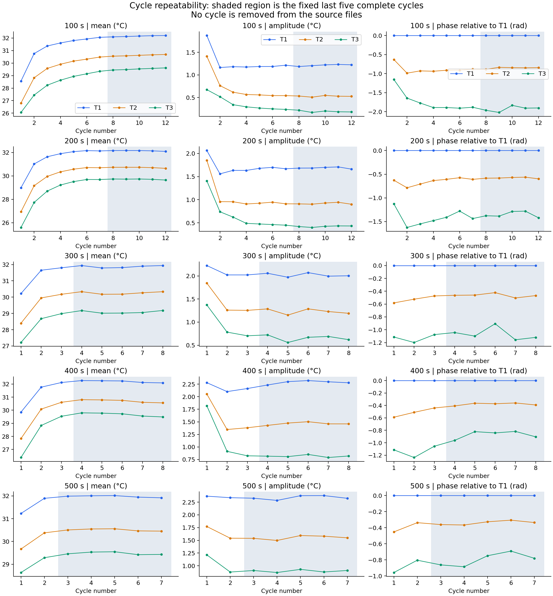
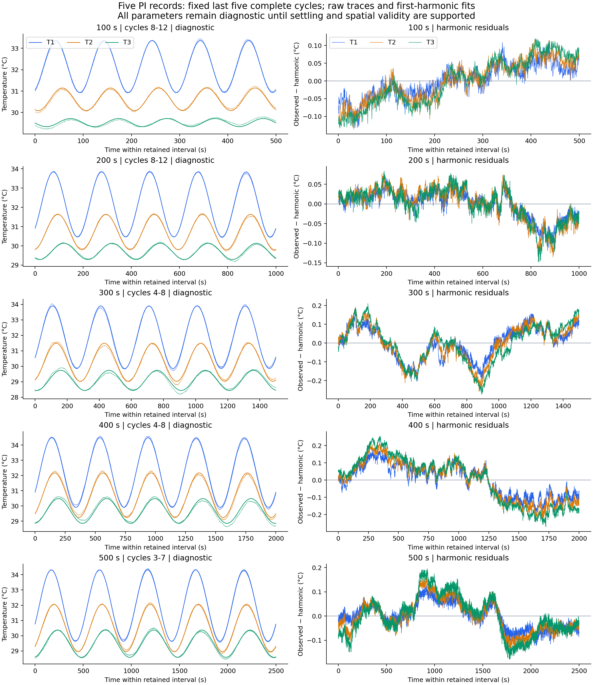
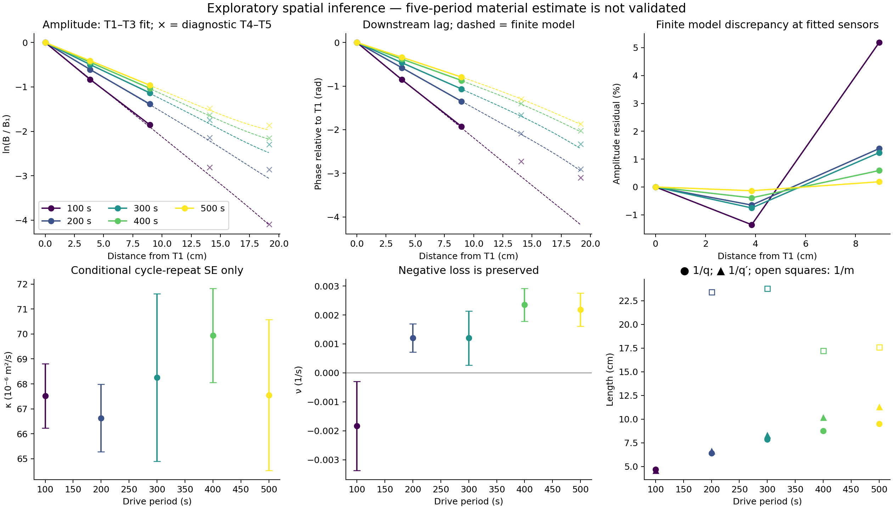

# Five-period record review and spatial fitting — November 18, 2026

Measured records exist at all five required drive periods. This review completes the recording audit, per-sensor harmonic fits, spatial fits, finite-rod correction and conditional uncertainty calculation. **The records support further analysis, but all five cannot yet be labelled qualified settled production data.** Thermal diffusivity is comparatively consistent across periods; the lateral-loss parameter is more sensitive to residual drift.

This was an offline analysis. No hardware commands were sent. Raw CSV rows and values were preserved. The analysis uses frozen complete-line byte prefixes; their sources, lengths and SHA-256 hashes are recorded in `../data/processed/five_period_review/m08_pi_five_period_sources.json`. Additional DONE-state logging does not change these frozen analysis intervals. Filenames were standardized after analysis without altering raw contents; the old-to-new mapping is in `../data/file_renames_20261118.csv`.

## Records and interval selection

Common settings were PI control, a 35 ± 5 °C request, Kp = 50 PWM/°C, Ki = 0.3 PWM/(°C·s), PWM limit = 96 and anti-windup enabled. All six temperature channels were retained. The primary spatial fits consistently use T1–T3. T4–T5 provide a sensor-inclusion sensitivity check; sensors were not selected to obtain a preferred parameter sign.

| Period / s | Original acquisition timestamp | Complete cycles | Primary analysis cycles | Device-time interval / s | RUNNING samples in full record |
|---|---|---:|---|---|---:|
| 100 | 20261116_104519_503645 | 12 | 8–12 | 704.983–1204.983 | 2400 |
| 200 | 20261109_095722_597413 | 12 | 8–12 | 1407.186–2407.186 | 5062 |
| 300 | 20261116_111157_767223 | 8 | 4–8 | 905.805–2405.805 | 4800 |
| 400 | 20261118_092100_447310 | 8 | 4–8 | 1374.687–3374.687 | 6400 |
| 500 | 20261109_104354_009745 | 7 | 3–7 | 1006.788–3506.788 | 7200 |

Intervals include the left endpoint and exclude the right endpoint. Complete-cycle counts use the STEP event, recorded coverage and sampling interval. A final RUNNING sample about half a second before a cycle boundary does not cause a completed cycle to be discarded. The partial thirteenth cycle at 200 s and partial eighth cycle at 500 s were excluded from the five-cycle fits. The 200 s record was stopped manually; its last measurement still reports RUNNING. It is not presented as an automatic DONE event or a measured final zero output.

Across the five RUNNING segments, there were no missing sequence numbers, duplicate or reversed timestamps, nonfinite temperatures or recorded protection faults. None of the selected last-five-cycle intervals contained output saturation. Other cycles remain in the raw files. Every contiguous five-cycle window was enumerated; details are in the corresponding `m08_pi_p<period>s_analysis.json` files.

## Settling checks

The review retains the original provisional planning scales: a five-cycle mean-temperature range ≤ 0.1 °C, amplitude range divided by mean amplitude ≤ 5%, and phase range ≤ 0.1 rad. **These are neither universal instructor-prescribed limits nor a final noise-validated acceptance definition.** Each range covers all five cycles rather than only the final pair.

| Period / s | Largest mean range across T1–T3 / °C | Largest relative amplitude range | Largest phase range / rad | Provisional gate |
|---|---:|---:|---:|---|
| 100 | 0.168 | 25.9% | 0.181 | Not passed |
| 200 | 0.093 | 8.1% | 0.140 | Not passed |
| 300 | 0.166 | 25.3% | 0.268 | Not passed |
| 400 | 0.311 | 7.5% | 0.191 | Not passed |
| 500 | 0.129 | 6.9% | 0.224 | Not passed |

No other enumerated five-cycle window passed all three provisional limits. The primary intervals were therefore kept fixed at the last five complete cycles. The 200 s record comes closest to the original planning limits. T3 amplitude variation is greatest at 100 and 300 s; the 400 s record has appreciable mean-temperature drift.

For a noise sensitivity check, each cycle's harmonic residuals were resampled using circular blocks of 10 s and 30 s, with 300 replicates per block length, preserving some temporal correlation. At 100 s, the T3 amplitude range is about 0.050 °C, compared with a largest single-cycle amplitude standard error of about 0.0084 °C across the two block scenarios. At 300 s the corresponding values are about 0.164 °C and 0.0185 °C. T3 phase ranges at 200/400/500 s are 0.140/0.191/0.224 rad; the largest single-cycle phase standard errors in the 30 s block scenario are about 0.013/0.021/0.015 rad. These changes cannot simply be dismissed as small independent noise.

The block lengths are sensitivity scenarios. These comparisons are not significance tests adjusted for selecting extrema, and do not cover long-term environmental changes, contact changes or systematic bias. They establish neither total uncertainty nor a new automatic acceptance threshold. The phase ranges in the table are relative to the drive time reference; the figure shows phase relative to T1 to make spatial lag easier to compare.



## Temporal and spatial fits

Each channel is fitted independently to `T = a + C cos(ωt) + S sin(ωt)`, giving `B = sqrt(C² + S²)` and `φ = atan2(-S,C)`. Spatial phases use nearest-branch unwrapping; adjacent phase differences among T1–T3 are smaller than π. This branch is consistent with the frequency trend, although sparse spatial sampling leaves branch ambiguity as a systematic check.

The boundary is the **measured T1 temperature**, rather than the TEC temperature or requested setpoint. The semi-infinite model fits `ln B` and `φ` linearly against x. The primary inference separately fits the unweighted complex transfer ratios to the finite rod with an insulated tip:

`F(x)/F(0) = cosh[(q + iq′)(L − x)] / cosh[(q + iq′)L]`.

Parameters follow from `κ = ω/(2qq′)` and `ν = κ(q² − q′²)`. Errors in the complex ratios share the T1 reference and are therefore correlated. The fit does not yet use a full measurement covariance matrix for optimal weighting; the joint cycle-to-cycle q/q′ covariance is used for conditional uncertainty propagation.

| Period / s | q / m⁻¹ | q′ / m⁻¹ | κ / (10⁻⁵ m²/s) | ν / (10⁻³ s⁻¹) |
|---|---:|---:|---:|---:|
| 100 | 21.258 | 21.889 | 6.75 ± 0.13 | −1.84 ± 1.54 |
| 200 | 15.653 | 15.061 | 6.66 ± 0.14 | 1.21 ± 0.49 |
| 300 | 12.747 | 12.036 | 6.83 ± 0.34 | 1.20 ± 0.93 |
| 400 | 11.417 | 9.835 | 6.99 ± 0.19 | 2.35 ± 0.57 |
| 500 | 10.515 | 8.846 | 6.75 ± 0.30 | 2.18 ± 0.58 |

The ± values are conditional standard errors propagated from the five-cycle parameter covariance. **They are not total measurement uncertainties or confidence intervals.** Drift also weakens the assumption of independent, identically distributed cycles. These errors should not be used to produce a precisely weighted final material estimate.

The five central κ estimates span 6.66–6.99 × 10⁻⁵ m²/s and are relatively close. The loss parameter ν involves subtracting two nearly equal squared quantities and is more sensitive to residual drift. The negative 100 s estimate is not evidence that the material generates heat: its difference from zero is only about 1.2 conditional standard errors. Adding a linear mean-temperature drift term changes the 100 s ν estimate from −1.84 × 10⁻³ to +0.24 × 10⁻³ s⁻¹. This sensitivity is a reliability warning; detrending does not automatically qualify the record as settled.

The linear-baseline sensitivity changes κ by approximately −1.54%, −0.30%, +0.03%, −3.03% and −0.47%, in increasing period order. T1's first-harmonic residual RMS divided by amplitude is about 2.0–4.0%, so the boundary waveform is approximately sinusoidal. The residual combines drift, noise and waveform distortion; it is not a pure harmonic-distortion measure.



## Model and geometry sensitivity

Using the same complex-ratio objective for both models, the finite-tip correction changes κ by approximately +0.01%, −0.22%, −0.60%, +0.37% and +1.73%. The largest complex-response differences within T1–T3 are approximately 0.04%, 0.35%, 1.03%, 1.64% and 2.25%. Parameter shifts and response errors are different quantities. The original linear lnB/φ fits are also retained; their differences from the complex-ratio fit include changes in weighting and objective, and cannot all be attributed to the finite tip.

Positive central ν estimates at 200–500 s give Bi⊥ ≈ 1.8–3.4 × 10⁻⁴, supporting the approximation of small transverse temperature differences. This does not establish settling or an insulated tip. The negative 100 s ν does not provide a physically meaningful Biot acceptance result. Parameter changes when T4/T5 are included are stored separately in JSON. Low-amplitude downstream channels provide sensitivity checks rather than replacing the primary three-sensor results.

The plotted lengths `1/q` and `1/q′` describe amplitude attenuation and one radian of phase lag, respectively. The mean-profile length `1/m = 1/sqrt(q² − q′²)` is plotted only for positive central ν values, giving about 17–24 cm. Its uncertainty becomes large as ν approaches zero. These points are not a validated common-parameter theoretical length curve.



Geometry is reused from the Module 7 mounting positions that the operator confirmed unchanged on November 16, 2026: x = [0, 0.0385, 0.0895, 0.1405, 0.1915] m, L = 0.2715 m and d = 0.01277 m.

- The Module 7 instrument record and A4 state that the reported caliper precision is 0.01 mm. This is not a known 1σ diameter uncertainty. Standard uncertainties in position and rod length were not supplied.
- The Module 7 stationary-fin note used a ±1 mm geometry sensitivity scenario. This review reuses that scenario only. Eight corner combinations independently perturb relative x2, x3 and L; the κ envelope changes by roughly ±3.5–4.1%. This is not a complete uncertainty bar. The actual cumulative coordinates may be correlated.
- The operator confirmed that room temperature was not recorded. Independently fitted means absorb constant offsets, so amplitude/phase analysis can proceed. These records cannot independently establish ambient changes over time, and no mean excess-temperature profile relative to ambient is fitted.
- Relative channel scan times were not measured. An assumed 0.17 s relative offset gives a phase sensitivity of about 0.0107–0.0021 rad over periods of 100–500 s. It is not a measured offset, a guaranteed bound or a standard error.
- Sourced density ρ and heat capacity c, with their uncertainties, have not been entered. Thermal conductivity k and air-side heat-transfer coefficient h are therefore not additionally reported. Contact effects, calibration, timing, correlated geometry errors and model discrepancy remain part of the final uncertainty budget.

## Interpretation and reproduction

Retain this analysis and its qualifications. If stricter settled-periodic evidence is needed, first investigate T3 stability at 100 and 300 s, then discuss the remaining phase or mean-temperature changes at 200/400/500 s with the instructor. Waiting longer for the TEC alone does not guarantee removal of the observed fluctuations; environmental conditions, probe contact and the full temperature histories also merit review. This review does not establish that every record must be repeated.

Current Stage 5 requires 100, 200, 300, 400 and 500 s records, each with at least five complete settled cycles. Stage 6 requires uncertainty and model checks: [course instructions](https://sethfraden.github.io/Phys39F26-course/labs/lab-09/#stage-5-production-data). The earlier output logic that treated two periods as a complete production record has been corrected.

Run from the repository root:

```sh
.venv/bin/python Module_8/python/analysis/five_period_review.py
.venv/bin/python -m unittest discover -s Module_8/python -p 'test_angstrom_fit.py'
```

Outputs are in `../data/processed/five_period_review/`: `m08_pi_five_period_summary.csv`, `m08_pi_five_period_summary.json`, `m08_pi_five_period_harmonic_fits.csv`, `m08_pi_five_period_cycle_fits.csv` and the per-period analysis JSON files. Figures are saved as PNG and PDF.

Independent normal-equation calculations verify the harmonic coefficients. Direct cosh evaluation and derivative-free grid refinement verify the primary finite-rod optimizer. Original source prefixes are checked before and after each run. Codex implemented the analysis and working notes; students must review and be able to explain the model and its limitations.

Validation completed before filename standardization: 33 related automated checks passed. Additional checks verified five unchanged raw prefixes, 30 full-interval harmonic fits, 282 cycle/channel fits, code fingerprints and six PNG/PDF files. All three figure groups were visually checked for layout, curves and units. Filename changes and regenerated outputs are validated separately in `../data/organization_verification_20261118.json`.
