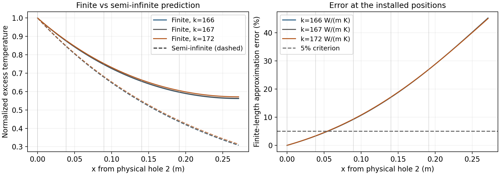

# A4: Finite-Rod Model and Validity Checks

**Yanheng Zhu | Phys 39 | Updated 2026-11-04**

**Assignment A4 | Due Monday, November 9, 2026, 9:05 AM (America/New_York)**

Repository: https://github.com/zhuyanheng/Phys39-teamR-X

The exact Git source checkpoint is embedded in the generated PDF and its build record. This is a provisional theoretical prediction, not a fit of the measured temperature profile. The rod diameter is measured; h and the conductivity range remain provisional theory inputs. A4 concerns Module 7 Parts I and II, not the Module 8 Angstrom measurement. References [1]-[4] are listed at the end.

## Geometry, property sources, and conventions

The operator identifies aluminum 6061; the course's more specific 6061-T6 identification is provisional until the temper is verified. The installed holes are 2, 5, 7, 8 and 9. Physical hole 2 defines x = 0, with positive x toward the tip; it is not physical hole 1.

| Quantity | Value | Status / source |
| --- | --- | --- |
| Diameter, d | 0.01277 m | Vernier caliper, reported precision 0.01 mm |
| Radius, R | 0.006385 m | d/2 |
| Area, A | 1.28077 x 10^-4 m^2 | pi d^2/4 |
| Perimeter, P | 0.0401181 m | pi d |
| A/P | 0.0031925 m | d/4 |
| Analysis length, L | 0.2715 m | Physical hole 2 to actual rod tip |
| Side coefficient, h | 10 W/(m^2 K) | Course provisional prediction value [3] |
| Conductivity envelope, k | 166-172 W/(m K) | 6061-T6, Table A.1, textbook p. 739 [1] |
| Central conductivity | 167 W/(m K) | Same table, 20 C value |

The 6061-T6 table lists k = 166 at 0 C, 167 at 20 C and 172 W/(m K) at 100 C. The envelope is conservative for the planned temperatures, not a confidence interval or measured sample property. It uses one temper throughout. The diameter was reported on 2026-11-04 as 12.77 mm measured by vernier caliper, with instrument precision 0.01 mm. The supplied instrument specification is not assumed to be a one-standard-deviation error; repeatability and ruler uncertainties were not supplied. The extra calculation digits allow reproduction, rather than asserting that precision.

| Channel / probe | Physical hole | x (m), from hole 2 |
| --- | --- | --- |
| A1 / T1 | 2 | 0.0000 |
| A2 / T2 | 5 | 0.0385 |
| A3 / T3 | 7 | 0.0895 |
| A4 / T4 | 8 | 0.1405 |
| A5 / T5 | 9 | 0.1915 |
| Actual tip, no probe | - | 0.2715 |

The reported segments 3.85 + 5.1 + 5.1 + 5.1 + 8 cm give L = 27.15 cm; hole 9 remains 8 cm from the tip. The 5.1 units are assumed cm pending confirmation. T1 is the rod boundary; A0 remains the separate TEC feedback/safety sensor.

<!-- pagebreak -->

## Part 1. Apply Fourier's law: Problem 1.3

The problem specifies a slab thickness of 0.010 m, a heat-flux magnitude of 5000 W/m^2, and a cold face at -40 C [1, p. 37]. I assume steady, one-dimensional conduction, no volumetric generation, and a constant tabulated conductivity for each calculation. The heat flux is q, not the total heat-transfer rate Q-dot.

Choose a coordinate s from the hot face toward the cold face. Fourier's law and its integral are

$$q=-k\frac{dT}{ds},\qquad q\delta=k(T_h-T_c),\qquad \Delta T=T_h-T_c=\frac{q\delta}{k}.$$

The positive heat flux is consistent with a negative temperature gradient in this coordinate. The units are

$$[\Delta T]=\frac{(\mathrm{W\,m^{-2}})(\mathrm{m})}{\mathrm{W\,m^{-1}K^{-1}}}=\mathrm{K}.$$

For pure silver, the 20 C entry in Table A.1 is 427 W/(m K). A complete sample calculation is

$$\Delta T_{\mathrm{Ag}}=\frac{(5000\ \mathrm{W\,m^{-2}})(0.010\ \mathrm{m})}{427\ \mathrm{W\,m^{-1}K^{-1}}}=0.1171\ \mathrm{K}.$$

Thus its hot face is -39.883 C. This reproduces the textbook's 0.117 C check. Applying the same expression to all seven materials gives:

| Material | k, W/(m K) | Rise, K | Hot face, C |
| --- | --- | --- | --- |
| Pure silver | 427 | 0.1171 | -39.883 |
| Pure aluminum | 237 | 0.2110 | -39.789 |
| Mild steel, 0.5% carbon | 54 | 0.9259 | -39.074 |
| Ice | 2.215 | 22.57 | -17.43 |
| Spruce, perpendicular to grain | 0.110 | 454.5 | 414.5 |
| 85% magnesia insulation | 0.067 | 746.3 | 706.3 |
| Silica aerogel | 0.024 | 2083 | 2043 |

Property entries: silver is from Table A.1, p. 740; aluminum and steel from p. 739. Ice is from Table A.2, p. 742 (0 C); spruce from p. 744 (20 C); magnesia and aerogel from p. 743 (38 C and 0 C respectively). These reference temperatures are not claimed to equal the temperatures throughout the slab.

### Physical judgment

For the metals, the predicted rises are small and the constant-property estimate is reasonable as an introductory calculation, although a more accurate result would use k near -40 C. The ice hot face remains below 0 C, so melting is not required; its temperature-dependent k can still change the numerical rise.

Spruce at a predicted 414.5 C would undergo substantial thermal degradation, and in an oxidizing environment may burn. It cannot remain the unchanged constant-k wood used in this calculation. The 2043 C aerogel result likewise cannot describe an unchanged low-temperature porous silica insulation: structural changes and additional heat-transfer mechanisms invalidate the fixed property.

The magnesia result needs a different qualification: 706 C is not automatically impossible for a refractory insulation. Rather, extending k = 0.067 from a 38 C table entry across a roughly 746 K rise is unjustified. The same table already gives k = 0.080 at 204 C. A quantitative high-temperature result requires k(T) and material stability information. A large mathematical temperature rise is a warning about the assumptions, not proof that every insulator must melt.

For variable conductivity, the replacement is q delta = integral of k(T) dT from the cold face to the hot face. The constant-k results above are estimates, not validated high-temperature operating conditions.

<!-- pagebreak -->

## Part 2. Build the stationary finite-rod model

For the rod, define excess and normalized temperature by

$$\theta(x)=T(x)-T_\infty,\qquad \theta_0=T(0)-T_\infty,\qquad \Theta(x)=\theta(x)/\theta_0.$$

T-infinity is the ambient temperature away from the apparatus. Temperature differences in kelvin and degrees Celsius have the same numerical value. The slab thickness in Part 1 is denoted delta so it is not confused with the rod analysis length L.

### Assumptions and energy balance

Consider a slice between x and x + dx of a uniform rod (Lienhard Fig. 4.8, p. 166 [1]; also [2]). Assume no internal heat generation; constant k, h, A and P; uniform ambient temperature; and a stationary state. Each cross section has one temperature, conditional on the small transverse Biot number checked in Part 4. Surface heat exchange is modeled with Newton cooling; a separate nonlinear radiation model is not included.

Heat enters the slice axially at x, leaves at x + dx, and is lost from the side area P dx. Using a positive heat rate toward increasing x,

$$\dot Q_x=-kA\frac{dT}{dx},\qquad \dot Q_{\mathrm{side}}=hP\,dx\,[T(x)-T_\infty].$$

The zero-storage balance is

$$\dot Q_x(x)-\dot Q_x(x+dx)-hP\,dx\,\theta(x)=0.$$

The side term is negative in the balance for a hot rod because it removes energy. For a rod colder than ambient, theta is negative and the same law describes heat entering from the surroundings. Dividing by dx and taking the limit gives

$$\frac{d\dot Q_x}{dx}+hP\theta=0.$$

Substitute Fourier's law with constant k and A:

$$-kA\frac{d^2\theta}{dx^2}+hP\theta=0,\qquad \frac{d^2\theta}{dx^2}-m^2\theta=0,\qquad m^2=\frac{hP}{kA}.$$

Unit checks make the geometry explicit:

$$[kA\theta'']=[hP\theta]=\mathrm{W\,m^{-1}},\qquad [m^2]=\frac{\mathrm{W\,m^{-1}K^{-1}}}{\mathrm{W\,m\,K^{-1}}}=\mathrm{m^{-2}}.$$

Thus m is an inverse length. For a circular rod, P/A = 4/d and m = square root of 4h/(kd).

### Boundary conditions and dimensionless form

At the analysis base, rod thermistor T1 supplies the temperature. At the tip, the provisional model assumes zero axial heat loss:

$$\theta(0)=\theta_0,\qquad \theta'(L)=0.$$

The first is a Dirichlet temperature condition, based on the measured rod temperature rather than the TEC command. The second is a Neumann zero-flux condition. It does not set the tip temperature equal to the room temperature. Treating the actual tip as insulated is an approximation to evaluate, not a statement that insulation has been observed.

Let xi = x/L. Then

$$\frac{d^2\Theta}{d\xi^2}=(mL)^2\Theta,\qquad \Theta(0)=1,\qquad \left.\frac{d\Theta}{d\xi}\right|_{\xi=1}=0.$$

The geometric coordinate xi puts the tip at 1. The alternative coordinate mx is also dimensionless, but puts the tip at mL. For an insulated tip there is no tip coefficient h_L in the boundary condition, so no independent tip Biot number is needed. The transverse Biot number remains a separate validity test.

### Solve the finite insulated-tip problem

The dimensional general solution of the second-order equation is

$$\theta(x)=C_1 e^{mx}+C_2 e^{-mx}.$$

The two boundary conditions give two independent equations:

$$C_1+C_2=\theta_0,\qquad C_1e^{mL}-C_2e^{-mL}=0.$$

Consequently, the constants are

$$C_1=\frac{\theta_0e^{-mL}}{2\cosh(mL)},\qquad C_2=\frac{\theta_0e^{mL}}{2\cosh(mL)}.$$

Substitution and the exponential definition of cosh yield

$$\theta(x)=\theta_0\frac{\cosh[m(L-x)]}{\cosh(mL)},\qquad \Theta(x)=\frac{\cosh[m(L-x)]}{\cosh(mL)}.$$

This is Lienhard Eq. (4.41). It explicitly retains the finite endpoint through both L and the zero-slope boundary there. Checks at the two ends are

$$\Theta(0)=1,\qquad \Theta'(x)=-\frac{m\sinh[m(L-x)]}{\cosh(mL)},\qquad \Theta'(L)=0.$$

The tip remains warmer than ambient for a heated base:

$$\Theta_{\mathrm{tip}}=\frac{1}{\cosh(mL)}.$$

The base heat rate follows by differentiating, not by identifying temperature with heat:

$$\dot Q_{0,\mathrm{ad}}=-kA\theta'(0)=kAm\theta_0\tanh(mL)=\sqrt{kAhP}\,\theta_0\tanh(mL).$$

The units of the last expression are watts because the square root has units W/K. The heat input balances the integrated side loss in the insulated-tip steady model.

### The two different resistance ratios

Across a cross section, the controlling ratio is

$$\mathrm{Bi}_\perp\sim\frac{R_{\mathrm{radial}}}{R_{\mathrm{surface}}}=\frac{h(A/P)}{k}=\frac{hd}{4k}.$$

Along the rod, compare axial conduction resistance L/(kA) with side-convection resistance 1/(hPL), using a common characteristic temperature scale:

$$\mathrm{Bi}_\parallel=\frac{L/(kA)}{1/(hPL)}=\frac{hPL^2}{kA}=(mL)^2.$$

A small transverse ratio permits a nearly uniform temperature within a section. The parallel ratio describes axial decay against distributed side loss. Neither a small transverse Biot number nor one-dimensionality alone establishes a semi-infinite rod.

<!-- pagebreak -->

## Part 3. Make a provisional finite-length prediction

### Problem 4.12: a long-rod limit with two fixed temperatures

Problem 4.12 specifies T(0) = T0 and T(L) = T-infinity [1, p. 186]. Its finite-tip boundary is therefore Dirichlet, not the insulated-tip Neumann condition from Part 2. With the same general solution, its constants obey

$$C_1+C_2=\theta_0,\qquad C_1e^{mL}+C_2e^{-mL}=0.$$

Solving these equations gives a sinh profile:

$$\frac{\theta(x)}{\theta_0}=\frac{\sinh[m(L-x)]}{\sinh(mL)}=\frac{e^{-mx}-e^{-2mL}e^{mx}}{1-e^{-2mL}}.$$

At fixed x, taking L to infinity makes the reflected exponential disappear:

$$\lim_{L\to\infty}\Theta(x)=e^{-mx}.$$

The insulated-tip solution has the corresponding exponential representation with plus signs:

$$\Theta_{\mathrm{ad}}(x)=\frac{e^{-mx}+e^{-2mL}e^{mx}}{1+e^{-2mL}}.$$

It has the same limit at a fixed measured position. The two different finite-end conditions become irrelevant sufficiently far from a receding tip; they are not the same finite problem. This limit need not be uniform near x = L, so the actual error must still be checked at each installed sensor. Differentiating the limiting profile gives

$$\dot Q_{0,\infty}=kAm\theta_0=\sqrt{kAhP}\,\theta_0.$$

### General convecting-tip comparison

For a tip exchanging heat with the same ambient, impose a Robin condition rather than zero flux:

$$-kA\theta'(L)=h_LA\theta(L),\qquad b=\frac{h_L}{mk}=\frac{\mathrm{Bi}_{\mathrm{tip}}}{mL},\qquad \mathrm{Bi}_{\mathrm{tip}}=\frac{h_LL}{k}.$$

Write the solution as D cosh[m(L-x)] + E sinh[m(L-x)]. At the tip the Robin condition gives E = bD, and at the base the temperature condition fixes D. Hence

$$\Theta_{\mathrm{conv}}(x)=\frac{\cosh[m(L-x)]+b\sinh[m(L-x)]}{\cosh(mL)+b\sinh(mL)}.$$

Its base heat rate is

$$\dot Q_{0,\mathrm{conv}}=\sqrt{kAhP}\,\theta_0\frac{\tanh(mL)+b}{1+b\tanh(mL)}.$$

Setting h_L = 0 gives b = 0 and recovers both insulated-tip formulas. These expressions distinguish omitting tip convection from omitting the far end altogether.

<!-- pagebreak -->

### Example 4.8 and Problem 4.20: quantify the tip approximation

Use the example's dimensions and properties, not our course rod's: d = 0.020 m, L = 0.080 m, k = 205 W/(m K), h = h_L = 120 W/(m^2 K), T0 = 150 C, and ambient = 26 C [1, p. 172]. Thus theta0 = 124 K. With A = pi d^2/4 and P = pi d,

$$m=10.8200\ \mathrm{m^{-1}},\qquad mL=0.865603,\qquad \mathrm{Bi}_{\mathrm{tip}}=0.0468293,\qquad b=0.0541002.$$

The two tip predictions are

$$\Theta_{\mathrm{tip,ad}}=0.714991,\qquad \Theta_{\mathrm{tip,conv}}=0.688934.$$

Converting the normalized excess temperatures back to absolute Celsius readings gives

$$T_{\mathrm{tip,ad}}=26+124(0.714991)=114.66\,{}^\circ\mathrm{C}.$$

$$T_{\mathrm{tip,conv}}=26+124(0.688934)=111.43\,{}^\circ\mathrm{C}.$$

The insulated model overpredicts the tip by 3.23 C. Measured relative to the exact *excess* temperature, its error is

$$\epsilon_{\mathrm{tip}}=\frac{0.714991-0.688934}{0.688934}=0.037823=3.78\%.$$

This reproduces the example's approximately 4% comparison; the small numerical difference from its printed intermediate values is rounding. A percentage of a Celsius absolute reading would depend on the arbitrary temperature zero and is not the comparison used here.

Problem 4.20 asks a different question: the error in the heat entering the base [1, p. 187]. The formulas on the previous page give

$$\dot Q_{0,\mathrm{ad}}=60.4107\ \mathrm{W},\qquad \dot Q_{0,\mathrm{conv}}=62.7134\ \mathrm{W}.$$

Using the convecting-tip calculation as the reference,

$$\epsilon_Q=\frac{62.7134-60.4107}{62.7134}=0.0367173=3.67\%.$$

The insulated-tip approximation underpredicts the heat input because it removes the extra tip-loss pathway. The 3.67% result matches the textbook's bracketed answer. Small error in this example does not establish an insulated tip or a semi-infinite approximation for our different rod.

### Error definition for our installed sensors

For a provisional 5% temperature criterion, compare the semi-infinite profile with the finite insulated-tip profile, using the latter as the denominator:

$$\epsilon_T(x)=\frac{|\Theta_{\mathrm{ad}}(x)-e^{-mx}|}{|\Theta_{\mathrm{ad}}(x)|}<0.05.$$

This is a model-to-model prediction at stated parameters, not a measured residual. In a heated rod the finite insulated-tip profile lies above the semi-infinite one. An independent equivalent expression is

$$\epsilon_T(x)=\frac{e^{-2m(L-x)}-e^{-2mL}}{1+e^{-2m(L-x)}}.$$

It gives zero error at the base and makes the growing influence of the tip toward the far end explicit.

<!-- pagebreak -->

### Numerical prediction for the course rod

Using the installed geometry, measured d = 0.01277 m, and fixed h = 10 W/(m^2 K), the conductivity envelope gives:

| k, W/(m K) | m, 1/m | 1/m, m | mL | Bi_parallel | Theta_tip |
| --- | --- | --- | --- | --- | --- |
| 166 | 4.3439 | 0.23021 | 1.17937 | 1.39092 | 0.56183 |
| 167 | 4.3309 | 0.23090 | 1.17583 | 1.38259 | 0.56347 |
| 172 | 4.2675 | 0.23433 | 1.15862 | 1.34239 | 0.57152 |

Thus the provisional m range is 4.267-4.344 m^-1 and mL is only 1.159-1.179. The predicted tip excess remains about 56-57% of the base excess, so the physical tip is not thermally remote.

| Probe / hole | x, m | Error at k=166 | Error at k=167 | Error at k=172 | Below 5% throughout? |
| --- | --- | --- | --- | --- | --- |
| T1 / 2 | 0.0000 | 0.00% | 0.00% | 0.00% | Yes, fixed boundary |
| T2 / 5 | 0.0385 | 3.32% | 3.33% | 3.37% | Yes |
| T3 / 7 | 0.0895 | 9.22% | 9.24% | 9.33% | No |
| T4 / 8 | 0.1405 | 17.11% | 17.13% | 17.21% | No |
| T5 / 9 | 0.1915 | 26.99% | 26.99% | 27.02% | No |

**Length conclusion.** For this geometry, h and k envelope, the semi-infinite approximation passes the 5% temperature criterion only at T1 and T2. It fails for the full retained five-sensor region, especially T3-T5. The finite insulated-tip model should therefore be retained for the planned spatial comparison. This prediction does not certify the real tip as insulated; the final data must test that boundary assumption and may require a convecting-tip model.



Solid curves show the finite insulated-tip prediction and dashed curves its semi-infinite approximation; vertical lines mark the installed positions. The close conductivity-envelope curves do not remove the much larger finite-end effect.

These theory predictions were first reconstructed on 2026-11-03 and updated on 2026-11-04 using the measured diameter, after the installation and earlier pilot runs. They are not represented as a pre-registered prediction made before the first heating. No fitted m from a drifting or relaxed-criterion run is used in A4.

<!-- pagebreak -->

## Part 4. Make a provisional one-dimensional prediction

For a circular section, the characteristic transverse length is A/P = R/2 = d/4. The perpendicular Biot number is

$$\mathrm{Bi}_\perp=\frac{h(A/P)}{k}=\frac{hd}{4k},\qquad [\mathrm{Bi}_\perp]=1.$$

Using exactly the same h and conductivity envelope as in Part 3 gives:

| k, W/(m K) | Bi_perp | Bi_parallel = (mL)^2 |
| --- | --- | --- |
| 166 | 0.00019232 | 1.39092 |
| 167 | 0.00019117 | 1.38259 |
| 172 | 0.00018561 | 1.34239 |

The algebraic cross-check follows from m^2 = 4h/(kd):

$$\mathrm{Bi}_\perp=\left(\frac{md}{4}\right)^2=\left(\frac{mR}{2}\right)^2.$$

Here m is the *predicted* value, not a fitted measurement. Both expressions give the same dimensionless numbers. The transverse ratio is about 1.86-1.92 x 10^-4, far below unity.

**Radius conclusion.** Under these provisional assumptions, internal radial conduction is much easier than heat loss from the section's surface. Each cross section should be represented adequately by one temperature, so a one-dimensional axial fin model is justified. This does not make the entire rod isothermal: the parallel ratio is of order 1.4 and an axial temperature gradient is expected.

This radius conclusion is separate from the length conclusion: **one-dimensional, yes; semi-infinite across all five positions at a 5% criterion, no.** Both are conditional predictions using a measured diameter, literature k and provisional h. Contact errors, an incorrect material identification, ambient nonuniformity and radiation can affect the later experimental comparison.

### Application: the same heat sink in still air and forced airflow

For the same heat sink in comparable conditions, forced airflow generally produces a larger convective coefficient than still air by replacing the warmed air near the surface more effectively. Hold the geometry and k fixed. Then

$$m=\sqrt{\frac{hP}{kA}}\propto\sqrt{h},\qquad \ell=\frac{1}{m}=\sqrt{\frac{kA}{hP}}\propto h^{-1/2}.$$

Thus increasing h makes the excess temperature decay over a shorter axial distance. For example, multiplying h by four doubles m and halves the decay length. At a fixed base excess temperature it also increases the heat flow into the fin; it does not mean the fin has become a better conductor. Transverse Biot also increases in proportion to h, so the one-dimensional approximation must be reconsidered if h becomes sufficiently large.

### Check of the main conclusions

Every heat-flux calculation in Part 1 has units W/m^2, every heat-rate calculation has units W, m has units m^-1, and the Biot numbers, mL, normalized temperature and relative errors are dimensionless. The two limiting profiles satisfy their own finite-end boundary conditions before the long-rod limit is taken. The quoted 0.117 K and 3.67% checks agree with the independent textbook answers.

<!-- pagebreak -->

## References, reproducibility, and completion status

[1] J. H. Lienhard IV and J. H. Lienhard V, *A Heat Transfer Textbook*, 6th ed., version supplied by the course. Problem 1.3: textbook p. 37 (PDF p. 51); fin derivation: Section 4.5, pp. 163-173; Example 4.8: p. 172 (PDF p. 186); Problems 4.12 and 4.20: pp. 186-187 (PDF pp. 200-201); Table A.1: pp. 739-740 (PDF pp. 753-754); Table A.2: pp. 742-744 (PDF pp. 756-758).

https://sethfraden.github.io/Phys39F26-course/references/lienhard-heat-transfer-textbook-v6.pdf

[2] Phys 39, Module 7 Part II, *Finite and Infinite Rod Theory*, course source checked 2026-11-03; submission requirements updated from the student-provided Moodle text on 2026-11-04. Equations (4.27)-(4.51), dimensionless variables and the distinction between transverse and parallel resistance ratios.

https://sethfraden.github.io/Phys39F26-course/labs/fin-design-derivation/

[3] Phys 39, Module 7 Part III, *A4: Finite-Rod Model and Validity Checks*, course source checked 2026-11-03; submission requirements updated from the student-provided Moodle text on 2026-11-04. Four-part requirements; provisional h = 10 W/(m^2 K); no measured stationary-profile data required.

https://github.com/SethFraden/Phys39F26-course/blob/main/course/labs/lab-08/index.md#a4-finite-rod-model-and-validity-checks

[4] Phys 39, Module 7 Part I, *Thermal Transport Foundations*, Problem 1.3 instructions and supporting reading questions.

https://sethfraden.github.io/Phys39F26-course/labs/theory-bridge-chapter-1/

Geometry provenance: the operator's 2026-10-30 record in `docs/module_notes/module_07_rod_instrument.md`, not a fit of the temperature data. Geometry uses physical holes 2, 5, 7, 8 and 9 and x = 0 at hole 2.

Reproduce the numerical tables and figure from the repository root:

```text
.venv/bin/python Module_7/python/analysis/a4_theory_checks.py
```

Numerical evidence is saved separately under `Module_7/data/processed/a4_predictions/`. The script verifies the boundary conditions, both long-rod limits, two independent relative-error expressions, the Biot identity, the silver check and Problem 4.20's 3.67% answer. Its outputs are provisional calculations, not sensor measurements.

Theoretical content completed: Parts 1-4, dimensional checks, stated 5% error criterion, actual installed positions, explicit coordinate origin, and separate length and radius conclusions. The superseded spacecraft-radiator application question is not used; the current airflow question is answered.

Measurement record updated 2026-11-04: d = 12.77 mm, vernier caliper, reported instrument precision 0.01 mm. Position/length uncertainties and repeated diameter readings have not been provided; no ruler precision or experimental certification is invented. The individual submission deadline above follows the student-provided Moodle assignment text, which supersedes the older public course calendar. The latest measured temperature record is not an input to these A4 predictions.

AI assistance disclosure: Codex assisted with the derivations, calculation script, drafting and document preparation. The named student must review the reasoning, verify the reported setup and be able to explain the work. No AI-generated number is presented as a measurement.
