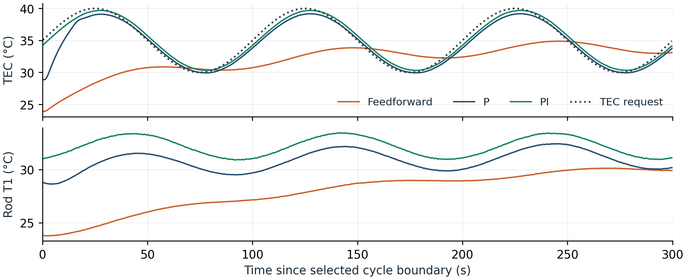
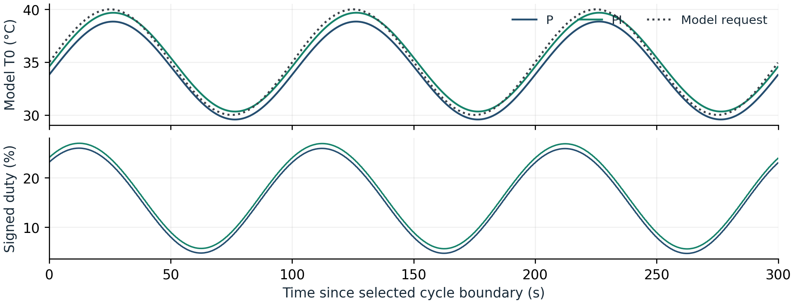
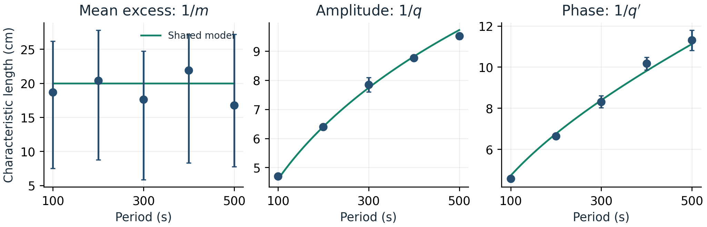
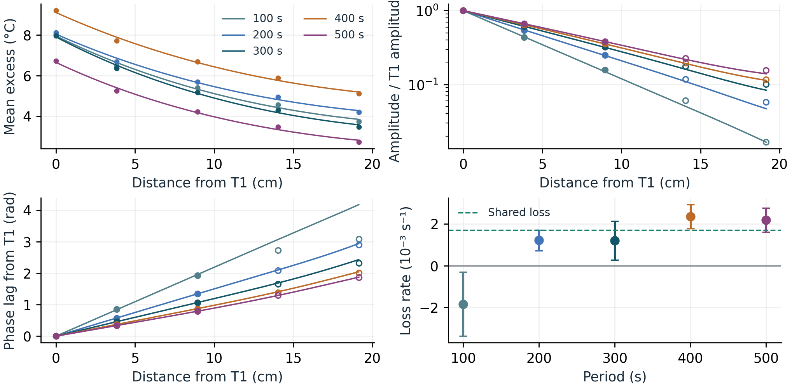
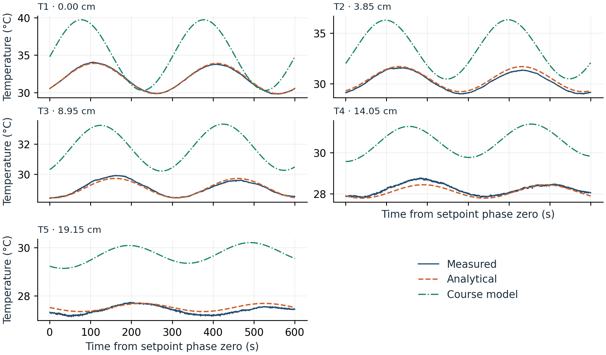

# Thermal waves in a driven aluminum rod

**Yanheng Zhu · Phys 39 · Assignment A5 · 2026-11-26**

**Repository** [https://github.com/zhuyanheng/Phys39-teamR-X](https://github.com/zhuyanheng/Phys39-teamR-X)

**Analysis code, figures and metrics** 41d3d68bd4c21eeee683f829df1841fea1c3ca22

**Raw data and earlier stage notes** [7a81e4c9365705941dd56a3ad5b6ae08153729f5](https://github.com/zhuyanheng/Phys39-teamR-X/commit/7a81e4c9365705941dd56a3ad5b6ae08153729f5)

The thermal wave weakened and lagged with distance. Across five periods, inferred diffusivity stayed within 6.66–6.99 × 10⁻⁵ m²/s, while the lateral-loss estimate varied more.

### Evidence and reproduction

[Team S18 evidence table](https://github.com/zhuyanheng/Phys39-teamR-X/blob/41d3d68bd4c21eeee683f829df1841fea1c3ca22/docs/module_notes/module_08_s18_evidence.md) · [Raw-data directory](https://github.com/zhuyanheng/Phys39-teamR-X/tree/7a81e4c9365705941dd56a3ad5b6ae08153729f5/Module_8/data/raw) · [Exact analysis commit](https://github.com/zhuyanheng/Phys39-teamR-X/commit/41d3d68bd4c21eeee683f829df1841fea1c3ca22) · [Figure code](https://github.com/zhuyanheng/Phys39-teamR-X/blob/41d3d68bd4c21eeee683f829df1841fea1c3ca22/Module_8/python/analysis/a5_figures.py) · [Model exports and settings](https://github.com/zhuyanheng/Phys39-teamR-X/tree/41d3d68bd4c21eeee683f829df1841fea1c3ca22/Module_8/data/simulation/a5)

- **S18.1–2** A0 was the TEC and A1–A5 were T1–T5 in unchanged holes. Rehearsal verified 0.5 s sampling and CSV–serial agreement. The common-bath check was skipped, leaving channel bias unquantified.
- **S18.3–4** At 100 s, RAW_ZERO gave a mean of 28.56 °C and amplitude of 3.58 °C. RAW_POS gave 37.92 °C and 0.54 °C. Fit residual RMS fell from 0.338 to 0.072 °C as the PWM bias and amplitude also changed.
- **S18.5–8** Feedforward used 23.33 ± 10.09 counts. At 100 s, feedforward, P and PI tracking RMS errors were 5.46, 1.19 and 0.60 °C.
- **S18.9–10** Across five cycles, the largest T1–T3 spans in mean, relative amplitude and phase were 0.168 °C, 25.9% and 0.181 rad at 100 s (704.983–1204.983 device s), and 0.093 °C, 8.1% and 0.140 rad at 200 s (1407.186–2407.186 device s). Both windows missed at least one provisional limit and serve as diagnostics.

Each item corresponds to rows in the attached team table. Codex assisted with the comparisons, figures and draft.

## Q1 · Making the TEC track a sinusoid

The reduced 35 + 5 sin(2πt/τ) °C request kept margin below the TEC (45 °C) and rod-base (56 °C) limits. I assess tracking by |mean error| ≤ 0.5 °C, amplitude ratio 0.90–1.10, |phase lag| ≤ 10°, and RMS error ≤ 1.0 °C.

**Figure 1a.** 100 s measured control. Feedforward, Nov 18 11:36, device time 6.956–306.956 s. P, Nov 18 11:42, 7.186–307.186 s. PI, Nov 16 10:45, 904.983–1204.983 s. Time is re-zeroed at a drive-cycle boundary. Feedforward and P include startup (cycles 1–3). PI uses cycles 10–12.

| Method | Kₚ / Kᵢ | Mean error (°C) | Amplitude ratio | Lag (°) | RMS (°C) | At cap |
| --- | --- | --- | --- | --- | --- | --- |
| Feedforward | — | −3.05 | 0.268 | 111.7 | 5.46 | 0/600 |
| P | 50 / 0 | −0.61 | 0.915 | 12.2 | 1.19 | 28/600 |
| PI | 50 / 0.30 | −0.002 | 0.938 | 9.34 | 0.60 | 0/600 |

**Table 1.** Gains in PWM counts/°C and PWM counts/(°C·s), respectively. Errors use the same intervals as Figure 1a. The 96-count cap affected the P startup. Different starts and settling windows limit the physical comparison.

<!-- pagebreak -->

## Q1 · Why the controllers differed

**Uncompensated PWM (S18.3–S18.4).** With RAW_ZERO (0 ± 50 counts), the 100, 200 and 300 s TEC amplitudes were 3.58, 5.98 and 7.87 °C. Lag behind PWM fell from 67.8° to 57.7° to 47.7°. Heat capacity attenuates and delays faster modulation. The 300 s result includes startup and only two full cycles. The Module 4 heating and cooling slopes were 0.495 and 0.141 °C/count, so equal positive and negative duty need not yield equal temperature changes. At 100 s, RAW_POS (32 ± 5 counts) reduced residual RMS from 0.338 to 0.072 °C, while the fitted amplitude also fell from 3.58 to 0.54 °C. Changing both bias and amplitude prevents attributing the smaller absolute residual to polarity alone. [Stage 2 measurements and one-lump checks](https://github.com/zhuyanheng/Phys39-teamR-X/blob/7a81e4c9365705941dd56a3ad5b6ae08153729f5/Module_8/docs/stage2_results.md).

**Feedback (S18.5–S18.7).** Static feedforward used 23.33 ± 10.09 PWM counts from the Module 4 heating slope and historical 23.44 °C baseline. It had no dynamic phase compensation or correction for the current thermal load. P supplied a correction from the instantaneous error. A positive average command still required a nonzero average error, and the P run clipped during startup. PI could maintain the average command through the integral term even when mean error was nearly zero.

**Tracking comparison (S18.8).** At 100 s, feedforward passed 0/4 criteria, P passed 1/4 (amplitude ratio), and PI passed 4/4 in the selected windows.

| Period | Selected Kₚ / Kᵢ | Mean error (°C) | Amplitude ratio | Lag (°) | RMS (°C) | Fit window (device s) |
| --- | --- | --- | --- | --- | --- | --- |
| 100 s | 50 / 0.30 | −0.0021 | 0.938 | 9.34 | 0.60 | 904.983–1204.983 |
| 200 s | 50 / 0.30 | +0.0011 | 0.959 | 5.45 | 0.36 | 1807.186–2407.186 |
| 300 s | 50 / 0.30 | −0.0001 | 0.966 | 4.07 | 0.27 | 1505.805–2405.805 |

**Table 2.** Measured PI, last three complete cycles. The same initial documented PI gains were carried into each period. No separate retuning trial was archived. None of the selected PI intervals had capped samples. PI passed all four criteria at 100, 200 and 300 s for the reduced request. None of the measured conditions approached 40 ± 16 °C. Even PI ran about 5 °C below the nominal mean and produced about 30% of the nominal amplitude.

**Figure 1b.** Focused Stage 3 reconstruction using the course six-sensor model, 700–1000 simulated s for both 100 s runs. It feeds back model T0 at the rod base. Gains 19.5 %/°C and 0.12 %/(°C·s) approximate the physical gains multiplied by 100/255. The P run sets Kᵢ to zero. Ambient is the course default 22 °C. Model dimensions are 270 × 12.8 mm.

In the common simulated window, PI moved the mean error from −0.795 to +0.001 °C and RMS error from 0.879 to 0.373 °C. The amplitude ratios were 0.927 and 0.936 and the lags 4.60° and 4.95°. Neither reached the model's cap in this window. Integral action primarily corrected the mean, with a small increase in lag. The physical controller senses the embedded TEC. Heat transfer between that sensor and the rod produces a further drop and lag visible in Figure 1a. Measured rod T1 therefore defines the boundary for the rod analysis.

<!-- pagebreak -->

## Q2 · Three lengths in the temperature field

I model axial conduction with constant diffusivity κ and distributed linear heat loss ν to ambient T∞. The rod begins at measured T1 (x = 0) and ends at L = 0.2715 m. I prescribe the measured T1 mean and first harmonic at the base and assume zero axial heat flux at the free tip. The transverse Biot number is checked in Q3.

For steady-periodic response, let s = q + iq′, m = √(ν/κ), and ω = 2π/τ. With T1 represented by a₁ + B₁ cos(ωt + φ₁), the finite-rod expression is

$$T(x,t)=T_\infty+(a_1-T_\infty)\frac{\cosh[m(L-x)]}{\cosh(mL)}+\mathrm{Re}\!\left[B_1 e^{i(\omega t+\phi_1)}\frac{\cosh[s(L-x)]}{\cosh(sL)}\right].$$

The first fraction describes how the mean excess temperature falls toward ambient. The magnitude and argument of the complex fraction give the oscillation attenuation and phase. Away from the tip, the corresponding exponential factors are exp(−mx), exp(−qx) and exp(−iq′x). In this limit, 1/m attenuates the mean excess by a factor e, 1/q attenuates the amplitude by a factor e, and 1/q′ is one radian of phase lag.

**Figure 2.** Lines use one common parameter pair, κ = 6.790 × 10⁻⁵ m²/s and ν = 1.698 × 10⁻³ s⁻¹, the medians of the positive-loss 200–500 s fits. Periods of 100, 200, 300, 400 and 500 s use PI runs from Nov 16 10:45, Nov 9 09:57, Nov 16 11:11, Nov 18 09:21 and Nov 9 10:43, respectively. Their device windows are 704.983–1204.983, 1407.186–2407.186, 905.805–2405.805, 1374.687–3374.687 and 1006.788–3506.788 s. Oscillatory bars show conditional fit errors. Mean points use five-sensor profile fits with initial TEC as the ambient proxy. Their bars show sensitivity to 20–28 °C ambient. [Run IDs and interval hashes](https://github.com/zhuyanheng/Phys39-teamR-X/blob/7a81e4c9365705941dd56a3ad5b6ae08153729f5/Module_8/data/processed/five_period_review/m08_pi_five_period_sources.json).

The shared model gives a period-independent mean length of 20.0 cm. The fitted 1/q grows from 4.7 cm at 100 s to 9.5 cm at 500 s, and 1/q′ from 4.6 to 11.3 cm. A typical hole spacing of about 5 cm is already about one attenuation length at 100 s, which leaves small amplitudes far down the rod. The longer drives retain more signal downstream, while the smaller phase gradient makes closely spaced phase measurements less informative. Figure 4 shows the spatial decay and lag at 300 s. From T1 to T3, the measured mean falls from 31.88 to 29.09 °C, the oscillation drops from 2.02 to 0.65 °C, and the lag increases by about 61°.

The tip condition can change the far-sensor response at long periods. I therefore use the finite-tip transfer in the fit and retain the semi-infinite scales for interpretation. [Derivation and validity checks](https://github.com/zhuyanheng/Phys39-teamR-X/blob/7a81e4c9365705941dd56a3ad5b6ae08153729f5/Module_8/docs/theory_and_analysis.md).

<!-- pagebreak -->

## Q3 · Inferring diffusivity and lateral heat loss

I fit a mean plus sine and cosine at the drive frequency to each temperature trace. I reference each sensor's complex amplitude to T1. In the semi-infinite form, the slope of log amplitude is −q and the slope of unwrapped phase is −q′. The finite-tip fit estimates both from the complex ratios of T1–T3. Substitution into the heat equation gives s² = (ν + iω)/κ. The imaginary and real parts give

$$\kappa=\frac{\omega}{2qq'},\qquad \nu=\kappa(q^2-q'^2).$$

**Figure 3.** Selected last five complete cycles at 100, 200, 300, 400 and 500 s. Device windows respectively are 704.983–1204.983, 1407.186–2407.186, 905.805–2405.805, 1374.687–3374.687 and 1006.788–3506.788 s. Oscillatory fits use filled T1–T3 points. Open T4–T5 points are checks. [Run IDs and interval hashes](https://github.com/zhuyanheng/Phys39-teamR-X/blob/7a81e4c9365705941dd56a3ad5b6ae08153729f5/Module_8/data/processed/five_period_review/m08_pi_five_period_sources.json).

| Period | q (m⁻¹) | q′ (m⁻¹) | κ (10⁻⁵ m²/s) | ν (10⁻³ s⁻¹) |
| --- | --- | --- | --- | --- |
| 100 s | 21.26 ± 0.42 | 21.89 ± 0.21 | 6.75 ± 0.13 | −1.84 ± 1.54 |
| 200 s | 15.65 ± 0.14 | 15.06 ± 0.24 | 6.66 ± 0.14 | +1.21 ± 0.49 |
| 300 s | 12.75 ± 0.40 | 12.04 ± 0.42 | 6.83 ± 0.34 | +1.20 ± 0.93 |
| 400 s | 11.42 ± 0.11 | 9.84 ± 0.30 | 6.99 ± 0.19 | +2.35 ± 0.57 |
| 500 s | 10.52 ± 0.11 | 8.85 ± 0.39 | 6.75 ± 0.30 | +2.18 ± 0.58 |

**Table 3.** ± values are conditional standard errors from cycle-to-cycle fits. The recorded ±1 mm bound per ruler gap and unquantified ambient drift and channel bias are separate limitations. The five windows all exceeded at least one provisional cycle-range criterion (0.10 °C mean, 5% amplitude, 0.10 rad phase).

The 100 s ν departs furthest from the shared value by 3.53 × 10⁻³ s⁻¹ (2.3 conditional standard errors) and lies 1.2 such errors from zero. A linear baseline drift term shifts it to +0.24 × 10⁻³ s⁻¹, leaving its sign unresolved. Drift is most consequential for ν because it comes from the difference of nearly equal squared slopes. The finite-tip correction changes the response by up to 2.25% at T1–T3. T4–T5 have smaller signals and stronger tip effects, especially at long periods. Positive-loss fits give transverse Biot numbers of 1.8–3.4 × 10⁻⁴, supporting a nearly uniform cross-section. The five-sensor mean-profile residual RMS is about 0.11 °C, but the fitted mean length depends on ambient. [Spatial fits, residuals and sensitivity calculations](https://github.com/zhuyanheng/Phys39-teamR-X/blob/7a81e4c9365705941dd56a3ad5b6ae08153729f5/Module_8/docs/five_period_review_2026-11-18.md).

<!-- pagebreak -->

## Q4 · One matched 300 s comparison

The analytical histories use the measured T1 waveform and geometry, with spatial parameters fitted to the same run. The course TEC–rod model uses aluminum 6061, L = 270 mm, diameter 12.8 mm, a 35 ± 5 °C request, and gains of 19.5 and 0.12 in duty-percent units. It generates its own T0 under feedback, with default 22 °C ambient and sensor lag. I interpolate to the physical probe positions and align by setpoint phase to preserve differences in rod-base timing.

**Figure 4.** Physical PI run Nov 16 11:11, device interval 905.805–2405.805 s for metrics. Course PI output uses 900–1800 simulated s. Panels show the first two complete cycles of each selected interval. The model feedback T0 maps to physical T1. Downstream model curves are interpolated in position, with no amplitude or phase adjustment.

| Channel | Measured (°C / °) | Analytical (°C / °) | Course model (°C / °) |
| --- | --- | --- | --- |
| T1 | 2.02 / 41.2 | 2.02 / 41.2 | 4.71 / 2.9 |
| T2 | 1.23 / 67.8 | 1.24 / 67.7 | 2.91 / 27.3 |
| T3 | 0.65 / 102.2 | 0.64 / 102.4 | 1.53 / 59.5 |

**Table 4.** First-harmonic amplitude and lag relative to the requested setpoint. Means and residuals are in the [comparison metrics](https://github.com/zhuyanheng/Phys39-teamR-X/blob/41d3d68bd4c21eeee683f829df1841fea1c3ca22/Module_8/data/processed/a5/a5_metrics.json).

Measured and simulated amplitudes at T3 are 0.32 and 0.33 of their respective base amplitudes. The analytical amplitude and lag agree with T3 within 0.01 °C and 0.2°, a consistency check using the same fitted data. The numerical T0 tracks the request much more closely than physical T1, with 4.71 versus 2.02 °C amplitude and 2.9° versus 41.2° lag. The absolute lag at T3 differs by 42.7°, while the delay added from T1 to T3 is 61.0° measured and 56.6° modeled.

### Conclusion

Amplitude decay and phase lag support κ ≈ 6.8 × 10⁻⁵ m²/s. The mean profiles and four oscillatory fits support lateral loss, with the 100 s estimate drift-sensitive and ambient unmeasured. Because 38.3° of the 42.7° lag difference at T3 is already present at the base, the next model test would use the TEC plate as the feedback sensor with other settings fixed.
